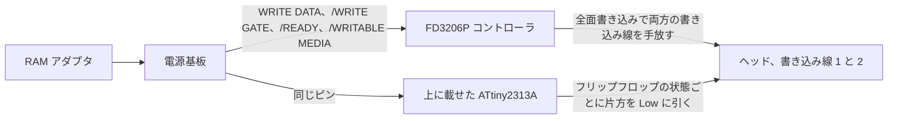

<div align="center">

<h1>fd3206-write-unlock</h1>

<strong>FD3206P コントローラの上に ATtiny2313A を 1 個はんだ付けすれば、ディスクシステムのドライブが再びディスク全面を書き込めるようになります。</strong>

[English](README.md) | 日本語 | [简体中文](README.zh-CN.md) | [繁體中文](README.zh-HK.md)

[](https://github.com/gufranco/fd3206-write-unlock/actions/workflows/ci.yml)
[](https://github.com/gufranco/fd3206-write-unlock/releases/latest)
[](https://github.com/gufranco/fd3206-write-unlock/actions/workflows/ci.yml)
[](https://scorecard.dev/viewer/?uri=github.com/gufranco/fd3206-write-unlock)
[](LICENSE)

</div>

<p align="center">
  <a href="#取り付け">取り付け</a> |
  <a href="#仕組み">仕組み</a> |
  <a href="#二つの書き込み制限">電源基板</a> |
  <a href="https://github.com/gufranco/fd3206-write-unlock/releases">リリース</a> |
  <a href="#よくある質問">よくある質問</a>
</p>

<p align="center">
はんだ付け <b>8</b> か所 · パターン切断 <b>0</b> · 追加部品 <b>0</b> · フラッシュ <b>230</b> バイト · <b>15</b> 命令のエッジ割り込み · MISRA C:2012 の指摘 <b>0</b> · シミュレーション <b>20</b> シナリオ
</p>

---

```text
ATtiny2313A, pin 1 over FD3206P pin 1
  solder  4 5 6 10 13 14 15 20
  clip    1 2 3 7 8 9 11 12 16 17 18 19
```

> [!IMPORTANT]
> ATtiny2313A と ATtiny4313 の両方を実機の FD3206P ドライブで試験し、ディスク全面の書き込みもゲームのセーブも正しく読み戻せました。書き込む前に、ディスクは必ずバックアップしてください。

<table>
<tr>
<td width="50%" valign="top">

**切断なし、追加なし**<br>
真下の FD3206P に 8 本のピンをはんだ付けするだけです。パターン切断も、配線も、抵抗も、2 個目のチップも要りません。

</td>
<td width="50%" valign="top">

**Low に引くだけ、High は出さない**<br>
書き込み線のピンは出力 0 か入力のどちらかなので、同じピンを共有する FD3206P とぶつかりません。

</td>
</tr>
<tr>
<td width="50%" valign="top">

**エッジからヘッドまで 10 サイクル**<br>
アセンブリの割り込みが、WRITE DATA の各立ち下がりから 1.25 us で書き込み線を切り替えます。最も近いエッジの間隔は 4.7 us です。

</td>
<td width="50%" valign="top">

**MISRA C:2012 の指摘ゼロ**<br>
C17 をデバッグ構成とリリース構成の両方で検査し、レジスタアクセスはすべて 1 つのアセンブリモジュールにまとめています。

</td>
</tr>
<tr>
<td width="50%" valign="top">

**全命令を実行**<br>
20 の simavr シナリオが各チップのリリース版イメージを 3 つのクロック周波数で実行し、実行されない命令が 1 つでもあれば失敗します。

</td>
<td width="50%" valign="top">

**書き込むのはテスト済みのもの**<br>
各リリースには、CI がビルドしてシミュレーションした hex そのものが、SHA-256 と署名付きのビルド証明とともに添付されます。

</td>
</tr>
</table>

## 課題

1988 年後半以降に作られたディスクシステムのドライブは、FD7201P に代わってミツミ製の FD3206P コントローラを搭載しています。FD3206P でも RAM アダプタは 1 ファイルを書き換えられますが、書き込みがディスク全面に及んだ時点でヘッドの 2 本の書き込み線を手放し、RAM アダプタはエラー 26 を表示します。このようなドライブでは、ディスク全体のバックアップも復元もできません。

従来の対策は、2 本のパターンを切断し、ドライブの書き込み段を 74LS76 フリップフロップと 74LS45 ドライバで作り直すものです。このファームウェアはその書き込み段と同じもので、コントローラの上に載るチップの中で動きます。

| | このファームウェア | GAL16V8 モッドチップ | 従来の配線改造 |
|:--|:--:|:--:|:--:|
| 追加部品 | チップ 1 個 | チップ 1 個 | 74LS76 と 74LS45 |
| ドライブ基板のパターン切断 | なし | なし | 2 か所 |
| 追加配線 | なし | 1 本、1 番から 19 番ピン | 複数 |
| 書き込み線のピン | Low に引くだけ | 両方向に駆動 | オープンコレクタ |
| 1 ファイルのセーブ中 | コントローラと短絡しない | コントローラとぶつかり得る | コントローラは切り離される |
| ソースとテスト | MIT、シミュレーション済み、MISRA 準拠 | オープン版は CUPL のソース | 回路図 |

## 仕組み



ドライブの読み書きヘッドは 1 つで、書き込み線は FD3206P の 14 番と 15 番ピンの 2 本です。どちらを Low に引くかでヘッド電流の向きが決まり、入れ替えるたびに磁化の反転が 1 回書き込まれます。

- **フリップフロップ。** WRITE DATA は 6 番ピン、つまり ATtiny の INT0 に入ります。立ち下がりエッジごとに、アセンブリの割り込み処理が次の書き込み線の状態をポートに書き、その後で次のエッジ用に事前計算した 2 つの値を入れ替えます。フラグにも C 側の状態にも触れません。
- **ゲート。** 片方の書き込み線を Low に引くのは、/READY、/WRITABLE MEDIA、/WRITE GATE がすべて Low の間だけです。メインループは 1 回の呼び出しで 3 つを読み、ウォッチドッグを更新し、条件が変わったら 2 つの値を計算し直します。その間に割り込みを止めるのは最大 12 サイクルです。
- **オープンドレイン。** 手放した書き込み線は、元のオープンコレクタのドライバと同じく、ドライブ自身のプルアップで High に保たれます。FD3206P は両方のピンを共有していますが、Low に引くだけのピンなら短絡しません。
- **入力のプルアップ。** 4 本の入力は ATtiny 内蔵の 20 から 50 kΩ のプルアップを使います。ATtiny が High と読むには 3.0 V が必要で、TTL の 2.0 V より高いため、プルアップで弱い TTL の High を 5 V 側へ引き上げます。電源基板もすでに /WRITE GATE を 10 kΩ でプルアップしています。
- **ウォッチドッグ。** 60 ms。リセットされると全ピンが入力になり、両方の書き込み線が解放されます。

8 MHz でのタイミング:

| 項目 | 値 | 根拠 |
|:--|:--|:--|
| 割り込み受付から書き込み線の切り替えまで | 10 サイクル、1.25 us | 命令数 |
| 割り込み処理全体 | 約 30 サイクル、3.75 us、エッジ間隔 4.7 us 未満 | 命令数 |
| エッジごとのばらつき | 最大 3 サイクル、375 ns | AVR の割り込み応答。メインループで最も長い命令は `ret` |
| ゲートの変化から書き込み線の解放または駆動まで | 最悪 7.4 us、7.2 MHz では 8.2 us、上限 10 us | メインループの 64 通りの位相でのシミュレーション |
| 同上、最速のデータエッジが続く間 | 最悪 19 us、7.2 MHz では 23 us、上限 100 us | シミュレーション |
| 条件の変化で割り込みを止める時間 | 12 サイクル、1.5 us | 命令数 |
| 内蔵発振器の許容差 | すべてのシナリオが 7.2、8.0、8.8 MHz で合格 | ±10 パーセントでのシミュレーション |

ドライブは 96.4 kHz、つまり 1 ビット 10.4 us で書き込むので、375 ns のばらつきは 1 ビットの 3.6 パーセントです。ゲートの変化は少なくとも 480 ビットあるブロック間のギャップで起きるため、数マイクロ秒の遅れはギャップを少し縮めるか延ばすだけです。

## 二つの書き込み制限

ドライブが全面書き込みを止める場所は二つあり、このチップが外すのはそのうちの一つです。

| 基板 | 書き込み制限 | 外し方 |
|:--|:--|:--|
| ドライブ機構、FD3206P コントローラ | 全面書き込みで書き込み線を手放す | このチップ |
| ドライブ機構、FD7201P コントローラ | なし | 不要 |
| 電源基板 FMD-POWER-04、-05、一部の -02、ツインファミコン AN-500 | 書き込み信号をドライブに届く前に止める回路 | 取り付け手順 2 |

FMD-POWER-01 の電源基板を持つ FD3206P のドライブは、チップだけで足ります。FD7201P のドライブはチップ不要ですが、手順 2 が必要な場合があります。

## 取り付け

### 必要なもの

| 品目 | 用途 |
|:--|:--|
| ATtiny2313A-PU または ATtiny4313-PU、DIP-20 | チップ本体。末尾に A の付かない ATtiny2313 と AT90S2313 は別の部品で、そのためのイメージはありません |
| USBasp、またはスケッチ例 ArduinoISP を書き込んだ Arduino Uno か Nano | チップへの書き込み |
| `avrdude` | macOS は `brew install avrdude`、Debian は `apt install avrdude` |
| テスター、1 kΩ の抵抗、フック付きプローブ | 手順 4 の測定 |
| 先の細いはんだごて | 手順 2 と 5 |
| Docker と Python 3 | ファームウェアを自分でビルドする場合のみ |

### 手順 1: 電源基板の版を確認する

1. 本体底面のプラスねじ 6 本を外します。
2. 本体を裏返し、上カバーを外します。
3. 電池ボックスのねじ 2 本を外し、電池ボックスをよけておきます。
4. 電源基板のねじを外し、基板を取り出します。
5. 部品面で、`©198X Nintendo` の横にある `FMD-POWER-XX` の型番を読みます。

| 型番 | 書き込み制限 | 作業 |
|:--|:--:|:--|
| FMD-POWER-01 | なし | 不要 |
| FMD-POWER-02、緑の子基板なし | なし | 不要 |
| FMD-POWER-02、緑の子基板あり | あり、子基板上 | 手順 2a |
| FMD-POWER-03 | 資料なし、-02 と同様と推定 | 子基板の有無を確認する。子基板がなく、チップを取り付けても全面書き込みが失敗する場合は、この基板を疑う |
| FMD-POWER-04 | あり | 手順 2b |
| FMD-POWER-05 | あり | 手順 2c |
| シャープのツインファミコン | あり、AN-505 はない可能性あり | 手順 2d |

### 手順 2: 電源基板の書き込み制限を外す

Famicom World の記事 [FDS Power Board Modifications](https://famicomworld.com/workshop/tech/fds-power-board-modifications/) には、各基板の写真に作業箇所がすべて印されています。以下の手順は各改造が何をするかを説明し、場所は記事の写真で確認します。

#### 2a. 子基板付きの FMD-POWER-02

1. 緑の子基板のはんだを外し、取り外します。
2. 残った穴のはんだを除去します。
3. 子基板からドライブ用コネクタのはんだを外します。
4. そのコネクタを電源基板本来の穴に取り付け、はんだ付けします。

これで制限のない -02 と同じ状態になります。

#### 2b. FMD-POWER-04

1. JP14 と表示された部品を、はんだを外すか切り取って取り除きます。これで制限回路が無効になります。
2. 記事で A、B と印された 2 点を短い線で結びます。近ければはんだブリッジでも構いません。これで書き込み信号が回路を迂回します。

この基板ではパターンを切断しません。

#### 2c. FMD-POWER-05

1. 記事で印された 2 本のジャンパ線のはんだを外します。1 本は RAM アダプタのコネクタ近くにある 2 個の黒い角形部品の下にあります。部品を少し外側に曲げると届きます。
2. 記事で赤く印された 2 本のパターンを切断し、どちらの切断箇所にも導通が残っていないことをテスターで確認します。
3. 記事で青く印された 2 本の配線をはんだ付けします。これで書き込み信号がドライブ機構へ戻ります。

#### 2d. シャープのツインファミコン

ツインファミコンは同じミツミ製のドライブ機構を、FD7201P か FD3206P 付きで、シャープ独自の電源基板の後ろに載せています。

1. 本体を開け、ドライブ機構のケーブルが経由している電源基板を探します。
2. 灰色の線を 2 本探します。1 本は電源基板に入り、もう 1 本は出ています。
3. 両方を電源基板のところで外すか、切断します。
4. 2 本の灰色の線同士をつなぎ、はんだ付けして絶縁します。これで書き込み信号が制限回路を通らなくなります。

> [!WARNING]
> 線の色は個体によって異なることがあります。切断する前に、2 本とも電源基板までたどってください。

nesdev フォーラムでの報告 `(as of 2026-09)`:

| 機種 | 報告 |
|:--|:--|
| ツインファミコン、機種の記載なし | Chris Covell 氏が 2014 年に写真付きで、2 本の線の改造で動作したと報告 |
| AN-500B、FD7201P のドライブ | 2014 年と 2018 年に二人の所有者が、必要なのは 2 本の線の改造だけと助言を受けた。どちらも結果は投稿していない |
| FD3206P のドライブを持つツインファミコン全般 | 2 本の線の改造後もコントローラの制限は残るため、チップも必要 |
| AN-505 | 2026-09-03 の投稿が、この機種には制限がないという Discord での議論を伝えている。写真や試験による裏付けはない |

### 手順 3: チップに書き込む

各[リリース](https://github.com/gufranco/fd3206-write-unlock/releases)には、チップごとに `fd3206-write-unlock-attiny2313a.hex` と `fd3206-write-unlock-attiny4313.hex` が、それぞれ `.sha256` ファイル付きで添付されています。USBasp の場合:

```sh
sha256sum -c fd3206-write-unlock-attiny2313a.hex.sha256
make fuses PROGRAMMER=usbasp
avrdude -c usbasp -p t2313a -U flash:w:fd3206-write-unlock-attiny2313a.hex:i
```

| 場合 | 変更点 |
|:--|:--|
| ATtiny4313 | `make fuses MCU=attiny4313` の後、avrdude に `-p t4313` と ATtiny4313 用のイメージを渡す |
| Arduino を書き込み器にする | `make fuses` に `PROGRAMMER=arduino_as_isp PORT=/dev/cu.usbmodemXXXX` を付ける |
| イメージを自分でビルドする | `make` がバージョン固定の Docker ツールチェーンでビルドし、`make flash PROGRAMMER=usbasp` で書き込む |

`make fuses` は下位 `0xE4`、つまり内蔵 8 MHz 発振器でクロック出力なし、上位 `0xD9`、つまり 4.3 V のブラウンアウトリセットでシリアル書き込み有効、拡張 `0xFF` を書き込みます。新品のチップは 4 MHz の発振器を 8 分周して動いています。ファームウェアは起動時に分周比を 1 に設定するので、ヒューズを書き換えていないチップでも 4 MHz で動作します。ただしエッジごとのばらつきは 2 倍になり、ブラウンアウトリセットもありません。

### 手順 4: ドライブを測る

チップを取り付けず、ディスクも入れない状態で測ります。

1. 電源オン: 14 番と 15 番ピンが待機時に 5.5 V 以下であること。約 5 V のはずで、それを超えると ATtiny のピンの定格を超えます。
2. 電源オン: 14 番ピンと GND の間に 1 kΩ の抵抗をつなぎ、14 番ピンの電圧 V を読み、15 番ピンでも同じことをします。測定 1 の待機電圧を V0 とすると、出力抵抗は 1000 x (V0 - V) / V Ω です。これが 250 Ω 以上なら、ATtiny が Low に引く線に流れる電流は 20 mA 以下に収まります。250 Ω 未満なら取り付けないでください。抵抗をつなぐのは数秒だけにします。ヘッドに電流が流れることがあり、そのためディスクは入れません。
3. FDSStick など、RAM アダプタではなくドライブに直接つなぐ機器を使う場合: 失っても構わないディスクを読んでいる間ずっと、4 番ピンの /WRITE GATE が 3.0 V 以上を保つこと。このチップは、書き込み可能なディスクが入った準備完了のドライブで 4 番ピンが Low になると書き込みます。初期の市販モッドチップは、FDSStick のソフトウェア 20160214 までは、FDSStick での読み込み中にディスクを消していました。4 番ピンが 3.0 V を下回るなら、このドライブではその機器でディスクを読まないでください。

### 手順 5: チップを取り付ける

| ATtiny のピン | FD3206P の信号 | 作業 |
|:--|:--|:--:|
| 4、PA1 | /WRITE GATE | はんだ付け |
| 5、PA0 | /WRITABLE MEDIA、Low で書き込み可 | はんだ付け |
| 6、PD2 INT0 | WRITE DATA | はんだ付け |
| 10 | GND | はんだ付け |
| 13、PB1 | /READY | はんだ付け |
| 14、PB2 | 書き込み線 2 | はんだ付け |
| 15、PB3 | 書き込み線 1 | はんだ付け |
| 20 | +5 V | はんだ付け |
| 1、2、3、7、8、9、11、12、16、17、18、19 | 資料なし | 切り落とす |

Famicom World の基板写真では 5 番ピンに /WRITE PROTECT と記されています。電源基板と RAM アダプタでは同じ信号を /writable media と呼びます。

1. 「切り落とす」とあるピンを曲げるか切り落とし、FD3206P に触れないようにします。ファームウェアはこれらを使わず、真下の FD3206P のピンが何をするかは誰も資料化していません。
2. ドライブ機構を取り出し、底板を外してコントローラ基板を出します。
3. ATtiny を FD3206P の上に、1 番ピン同士を合わせ、両方の切り欠きを同じ向きにして載せます。
4. 「はんだ付け」とある 8 本のピンを、真下の FD3206P のピンにはんだ付けします。
5. 電源を切ったまま、隣り合うピン同士がつながっていないこと、20 番ピンと 10 番ピンが短絡していないことをテスターで確かめます。交換のきかない FD3206P 上のはんだブリッジが、ドライブを壊す最もありそうな原因です。
6. チップの上に当たる部分にテープを貼って、底板を戻します。

### 手順 6: 試験する

書き込む前にどのディスクもバックアップし、失っても構わないディスクで試験してください。

1. ゲームをセーブし、セーブを読み返します。[1 ファイル単位のセーブ](#1-ファイル単位のセーブ)を参照してください。
2. ディスク書き込みツールでディスク全面を書き換え、何度か読み返します。
3. 書き込み中、Low に引かれているピンが 0.8 V 以下であること。
4. ロジックアナライザを 6 番ピンと 14、15 番ピンにつなぐと、WRITE DATA の立ち下がりエッジのたびに Low の状態が一方の書き込み線からもう一方へ移ること。

それでも全面書き込みが失敗する場合は、書き込み中に WRITE DATA と /WRITE GATE が FD3206P の 6 番と 4 番ピンに届いているかを確認します。届いていなければ、電源基板がまだ信号を止めています。

## 動作要件

各要件は、各チップのリリース版イメージを 7.2、8.0、8.8 MHz で実行するシミュレーションのシナリオで検査しています。ゲートと書き込み線の選択は、入力ポートの 65,536 通りの全組み合わせでも検査しています。

| 要件 | シナリオ |
|:--|:--|
| /READY、/WRITABLE MEDIA、/WRITE GATE がすべて Low でない限り、両方の書き込み線のピンは入力でなければならない | 条件の 1 つが High、立ち下がりエッジ 100 回: 各エッジの後で両方の書き込み線が解放されている |
| 書き込み中は、ちょうど 1 本の書き込み線のピンが Low でなければならず、WRITE DATA の立ち下がりエッジごとに入れ替わらなければならない | 4.7 us 間隔のエッジ 1000 回: 各エッジの後で 1 本だけが Low、毎回もう一方に移る |
| WRITE DATA の立ち上がりエッジで書き込み線が変わってはならない | 1 us の Low パルス: 書き込み線は立ち下がりで 1 回だけ変わる |
| 書き込みを始める書き込み線は、従来のフリップフロップと同じく、書き込み線を解放している間も立ち下がりエッジの数に従わなければならない | ゲートを閉じたまま 100 または 101 エッジの後にゲートを開く: 偶数なら書き込み線 1、奇数なら書き込み線 2 |
| WRITE DATA が Low のままで書き込み線が再び変わってはならない | 20 us の Low: 書き込み線は立ち下がりで 1 回だけ変わる |
| ゲートが開く最中に来たエッジを取りこぼしてはならない | ゲートを開いてから 96 通りのサイクル位置でエッジ: その後の書き込み線は常にエッジの数と一致する |
| いずれかの条件が High になってから 10 us 以内に書き込み線を解放しなければならない | 各条件を順に、以後エッジなし: 10 us 以内に両方が解放される |
| すべての条件が Low になってから 10 us 以内に、ちょうど 1 本の書き込み線を駆動しなければならない | 他が Low のまま /WRITE GATE が立ち下がる: 10 us 以内に 1 本が Low |
| 書き込みゲートのグリッチの後、書き込み線は解放された状態で終わらなければならない | 250 ns のゲートパルス: その後は両方が解放 |
| 起動後、出力になっているピンがあってはならず、すべての入力にプルアップがなければならず、書き込み線のピンにはあってはならない | 全入力 High: 方向レジスタはすべて 0、4 本の入力にプルアップ、書き込み線にはなし |
| 最速のデータエッジが続く間に /WRITE GATE が High になってから 100 us 以内に書き込み線を解放しなければならない | 最速のデータ中にゲートを閉じる: 100 us 以内に解放し、続く 100 エッジも解放のまま |
| 最速のデータエッジが続く間に /WRITE GATE が Low になってから 100 us 以内に、ちょうど 1 本の書き込み線を駆動しなければならない | 最速のデータ中にゲートを開く: 100 us 以内に 1 本が Low、以後エッジごとに入れ替わる |
| ファームウェアは分周なしのクロックで動き、ウォッチドッグを有効にしておかなければならない | 8 分周で起動するチップの起動後: 分周比 1、タイムアウト 60 ms でウォッチドッグ有効 |
| 通常動作中にウォッチドッグが発動してはならない | タイムアウトの 10 倍にあたる 600 ms のエッジ: リセットなし、各エッジの後で 1 本だけが Low |
| メインループが止まった場合はウォッチドッグがリセットし、書き込みが再開しなければならない | ループを 100 ms 停止: ウォッチドッグのリセットが 1 回、その後の 100 エッジで 1 本だけが Low になり交互に切り替わる |

## 1 ファイル単位のセーブ

1 ファイル単位のセーブでは、FD3206P も同じ 2 本のピンに自分のフリップフロップで書き込み、ATtiny も自分のフリップフロップで同じピンを駆動します。二つが食い違えば両方の線が同時に Low に引かれ、ヘッドには正味の電流が流れず、そのセーブは正しく書かれません。

二つはそろって動きます。このファームウェアは GAL 方式のモッドチップと完全に同じ位相を保ち、0 から始まり、最初に書き込み線 1 を駆動し、立ち下がりエッジのたびに切り替わります。どちらのチップを取り付けた実機の FD3206P ドライブでも、ゲームのセーブは正しく読み戻せました。

## 数値

<!-- figures:begin -->
| 項目 | 値 |
|---|---|
| フラッシュ使用量 | ATtiny2313A で 230 バイト、ATtiny4313 で 234 バイト |
| エッジ割り込みハンドラ | 15 命令 |
| ファームウェアのソース | 空行を除き 194 行 |
<!-- figures:end -->

リリース版のビルドから測定した値です。ATtiny4313 のイメージが 4 バイト大きいのは、RAM が大きいため起動時にスタックポインタの上位バイトを設定する必要があるからで、チップごとにイメージが分かれているのも同じ理由です。

## よくある質問

<details>
<summary><strong>自分のドライブに必要ですか？</strong></summary>
<br>

コントローラが FD3206P の場合だけです。ドライブ機構を開け、コントローラ基板の大きなチップの型番を読んでください。FD7201P にはコントローラ側の制限はありませんが、電源基板は手順 2 が必要な場合があります。

</details>

<details>
<summary><strong>ATtiny85 などの 8 ピンのチップでは駄目ですか？</strong></summary>
<br>

書き込み段には WRITE DATA、3 つの条件、2 本の書き込み線の計 6 本の I/O が必要です。8 ピンの ATtiny は RESET を手放さない限り 5 本しかなく、RESET を手放すとインシステムプログラミングができなくなります。さらに x313 だけが、FD3206P の GND、+5 V、WRITE DATA とちょうど同じ位置に GND、VCC、INT0 を持っており、これが重ねて取り付けられる理由です。

</details>

<details>
<summary><strong>「V4」モッドチップで持ち上げられている 2 本のピンは何ですか？</strong></summary>
<br>

1 番と 19 番のピンで、線でつながっています。レジスタモードの GAL16V8 はフリップフロップのクロックを 1 番ピンの立ち上がりエッジからしか取れず、ドライブは WRITE DATA の立ち下がりエッジで反転するので、GAL は WRITE DATA を反転して出力ピン 19 に出し、自分のクロックピンに戻しています。どちらもリセットではありません。市販の「FD3206 Add-On Chip V4」は刻印を消して販売されていますが、取り付け写真に同じジャンパが写っているので、同じ GAL 方式である可能性が高いと考えられます。これは写真からの推測です。ATtiny ではこの折り返しは不要で、INT0 が立ち下がりエッジで直接割り込みます。

</details>

<details>
<summary><strong>Arduino IDE でビルドできますか？</strong></summary>
<br>

できません。Arduino IDE は、書き込み器として使う Arduino に ArduinoISP を書き込むためだけに使います。ファームウェアはバージョン固定のツールチェーンでビルドし、どのチップにも MISRA の検査、テスト、シミュレーションを通ったイメージが書き込まれるようにしています。

</details>

<details>
<summary><strong>シャープのツインファミコンでも使えますか？</strong></summary>
<br>

ドライブ機構が同じなので、FD3206P の個体には同じようにチップを取り付けられます。電源基板には独自の制限があり、手順 2d で 2 本の灰色の線をつないで外します。

</details>

## バージョン管理

リリースは [Semantic Versioning](https://semver.org/) に従い、CI が通った後に `main` から自動で作られます。各[リリース](https://github.com/gufranco/fd3206-write-unlock/releases)にはリリースノート、チップごとの hex とその SHA-256、署名付きビルド来歴の Sigstore バンドル、両方のイメージに証明を結び付けた SPDX 形式のソフトウェア部品表、MIT ライセンスの本文が付きます。来歴は GitHub ホストのランナーで作成され、SLSA Build Level 2 を満たします。ダウンロードしたファイルは次のコマンドで検証できます。

```sh
gh attestation verify fd3206-write-unlock-attiny2313a.hex --repo gufranco/fd3206-write-unlock
```

## サポート

| 用件 | 窓口 |
|:--|:--|
| 不具合報告、実機での結果 | [GitHub Issues](https://github.com/gufranco/fd3206-write-unlock/issues) |
| セキュリティの報告 | [セキュリティポリシー](SECURITY.md) |

## 出典

公開資料だけをもとに独自に書いています。コードとこの README の根拠は次の資料だけです。

| 資料 | 採った事実 |
|:--|:--|
| Famicom World「[Famicom Disk System FD3206 Write Mod](https://famicomworld.com/workshop/tech/famicom-disk-system-fd3206-write-mod/)」 | 注記付きの基板写真にある FD3206P の +5 V、GND、/READY、/WRITE GATE、/WRITABLE MEDIA、WRITE DATA のパッド、ただし 5 番ピンの表記は /WRITE PROTECT。14 番と 15 番ピンの書き込み線配線、74LS76 と 74LS45 の回路図にある書き込み線駆動の動作 |
| Famicom World「[FDS Power Board Modifications](https://famicomworld.com/workshop/tech/fds-power-board-modifications/)」 | 書き込み制限を持つ電源基板の版と、それぞれの外し方 |
| nesdev フォーラムのスレッド [11342](https://forums.nesdev.org/viewtopic.php?t=11342)、[17037](https://forums.nesdev.org/viewtopic.php?t=17037)、[19856](https://forums.nesdev.org/viewtopic.php?t=19856) と「[Disable copy protection on the Twin Famicom AN-505BK](https://forums.nesdev.org/viewtopic.php?p=310336)」 | ツインファミコンの電源基板の改造と機種別の報告 |
| Brad Taylor「[Famicom Disk System technical reference](https://www.nesdev.org/FDS%20technical%20reference.txt)」、nesdev.org | 96.4 kHz のビットレート、10 パーセントの許容差、1 us のパルス、信号名 |
| nesdev wiki「[FDS RAM adaptor cable pinout](https://www.nesdev.org/wiki/FDS_RAM_adaptor_cable_pinout)」と「[FDS disk format](https://www.nesdev.org/wiki/FDS_disk_format)」 | 信号名と極性、ギャップ長 |
| Microchip 資料 8246、[ATtiny2313A/4313](https://ww1.microchip.com/downloads/en/DeviceDoc/doc8246.pdf) | ピン配置、入出力レベル、割り込み、ウォッチドッグと分周器の時間制限付き手順、発振器の精度、電源電圧範囲、ピン電流 |
| nesdev フォーラム、[FMD-POWER-05](https://forums.nesdev.org/viewtopic.php?t=17881) の解析済み回路図 | ドライブ基板に届く電源は +5 V とモーター用 +5 V だけであること、/write の 10 kΩ プルアップ、信号名 /writable media |
| [avrdude 8](https://github.com/avrdudes/avrdude/blob/main/src/avrdude.conf.in) のデバイスデータベース | ヒューズビットの意味と工場出荷値 |
| [FDSStick](https://www.fdsstick.com/the-latest-fd3206-modchip-v4-no-need-any-wires/) と [ToToTEK](https://www.tototek.com/store/index.php?main_page=product_info&products_id=228) の FD3206 V4 アドオンチップの製品ページ | 8 か所のはんだ付けと 1 番から 19 番へのジャンパが写った取り付け写真。上記の比較にのみ使用 |

[Stephen-Arsenault/FDS-FD3206-Modchip](https://github.com/Stephen-Arsenault/FDS-FD3206-Modchip)、CC BY-SA 4.0 は、同じコントローラにプログラマブルロジックを載せるプロジェクトです。そのファイル、ソース、写真、文書、名称はここに一切含まれておらず、コントローラのピン番号も同プロジェクトからではなく Famicom World の基板写真で確認しています。機能が同じなのはドライブの機能だからです。表現は異なります。GAL は組み合わせ論理と、線の折り返しでクロックを入れるレジスタで、こちらは C のメインループと、事前計算した 2 つのポート値を入れ替えてピンをオープンドレインで駆動するアセンブリの割り込み処理です。4 行以上一致する箇所はなく、ファームウェアに第三者のコードは含まれていません。

## ライセンス

[MIT](LICENSE)
