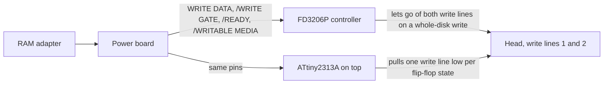

<div align="center">

<h1>fd3206-write-unlock</h1>

English | [日本語](README.ja.md) | [简体中文](README.zh-CN.md) | [繁體中文](README.zh-HK.md)

<br>

<strong>Solder one ATtiny2313A on top of the FD3206P controller, and a Famicom Disk System drive writes whole disks again.</strong>

<br>
<br>

[](https://github.com/gufranco/fd3206-write-unlock/actions/workflows/ci.yml)
[](https://github.com/gufranco/fd3206-write-unlock/releases/latest)
[](https://scorecard.dev/viewer/?uri=github.com/gufranco/fd3206-write-unlock)
[](https://github.com/gufranco/fd3206-write-unlock/actions/workflows/ci.yml)
[](LICENSE)

</div>

<p align="center">
  <a href="#install">Install</a> &nbsp;|&nbsp;
  <a href="#how-it-works">How it works</a> &nbsp;|&nbsp;
  <a href="#two-lockouts">Power board</a> &nbsp;|&nbsp;
  <a href="https://github.com/gufranco/fd3206-write-unlock/releases">Releases</a> &nbsp;|&nbsp;
  <a href="#faq">FAQ</a>
</p>

<p align="center">
<b>8</b> solder points · <b>0</b> trace cuts · <b>0</b> extra parts · <b>230</b> bytes of flash · <b>15</b>-instruction edge handler · <b>0</b> MISRA C:2012 findings · <b>20</b> simulation scenarios
</p>

---

```text
ATtiny2313A, pin 1 over FD3206P pin 1
  solder  4 5 6 10 13 14 15 20
  clip    1 2 3 7 8 9 11 12 16 17 18 19
```

> [!IMPORTANT]
> Every host, static and simulation check passes, but the firmware has not run in a real drive yet. Make the first write on a disk you can lose.

<table>
<tr>
<td width="50%" valign="top">

**Nothing cut, nothing added**<br>
Eight pins soldered to the FD3206P underneath. No trace cut, no wire, no resistor, no second chip.

</td>
<td width="50%" valign="top">

**Pulls low, never drives high**<br>
Each write-line pin is either an output at 0 or an input, so it cannot fight the FD3206P on the pin they share.

</td>
</tr>
<tr>
<td width="50%" valign="top">

**10 cycles from edge to head**<br>
An assembly interrupt switches the write line 1.25 us after each WRITE DATA fall; the closest edges are 4.7 us apart.

</td>
<td width="50%" valign="top">

**MISRA C:2012, zero findings**<br>
C17 checked in its debug and release configurations, with every register access kept in one assembly module.

</td>
</tr>
<tr>
<td width="50%" valign="top">

**Every instruction executed**<br>
20 simavr scenarios run each chip's release image at three clock speeds and fail if any instruction never runs.

</td>
<td width="50%" valign="top">

**You flash what was tested**<br>
Each release attaches the exact hex CI built and simulated, with its SHA-256 and a signed build attestation.

</td>
</tr>
</table>

## The problem

Famicom Disk System drives made from late 1988 carry the Mitsumi FD3206P controller instead of the FD7201P. The FD3206P still lets the RAM adapter rewrite one file, but it lets go of the head's two write lines as soon as a write covers the whole disk, and the RAM adapter shows error 26. Such a drive cannot back up or restore a full disk.

The classic fix cuts two traces and rebuilds the drive's write stage from a 74LS76 flip-flop and a 74LS45 driver. This firmware is that same write stage, running in a chip that sits on the controller.

| | This firmware | GAL16V8 modchips | Classic wired mod |
|:--|:--:|:--:|:--:|
| Parts added | 1 chip | 1 chip | 74LS76 and 74LS45 |
| Trace cuts on the drive board | none | none | 2 |
| Extra wires | none | 1, pin 1 to pin 19 | several |
| Write-line pins | pull low only | driven both ways | open collector |
| During single-file saves | cannot short against the controller | can drive against the controller | controller is cut off |
| Source and tests | MIT, simulated, MISRA-clean | CUPL source for the open version | schematic |

## How it works



The drive has one read/write head with two write lines, on FD3206P pins 14 and 15. Pulling one of them low sets the direction of the head current, and every swap writes one flux reversal.

- **Flip-flop.** WRITE DATA arrives on pin 6, the ATtiny's INT0. On each falling edge an assembly handler writes the next write-line state to the port, then swaps two precomputed values for the edge after. It changes no flags and no C state.
- **Gate.** One write line is pulled low only while /READY, /WRITABLE MEDIA and /WRITE GATE are all low. The main loop samples the three in one call, services the watchdog, and recomputes the two values when a condition changes, with interrupts off for at most 12 cycles.
- **Open drain.** A released line is held high by the drive's own pull-ups, as with the original open-collector driver. The FD3206P shares both pins, and a pin that only pulls low cannot short against it.
- **Input pull-ups.** The four inputs keep the ATtiny's 20 to 50 kOhm pull-ups. The ATtiny needs 3.0 V to read a high where TTL needs 2.0 V, and the pull-up lifts a weak TTL high toward 5 V. The power board already pulls /WRITE GATE up with 10 kOhm.
- **Watchdog.** 60 ms. A reset leaves every pin an input, which releases both write lines.

Timing at 8 MHz:

| Measure | Value | Source |
|:--|:--|:--|
| Interrupt taken to write line switched | 10 cycles, 1.25 us | instruction count |
| Whole handler | about 30 cycles, 3.75 us, under the 4.7 us edge spacing | instruction count |
| Variation between edges | up to 3 cycles, 375 ns | AVR interrupt response, longest main-loop instruction `ret` |
| Gate change to write lines released or engaged | 7.4 us worst, 8.2 us at 7.2 MHz; limit 10 us | simulation across 64 main-loop phases |
| Same, with data edges at the fastest rate | 19 us worst, 23 us at 7.2 MHz; limit 100 us | simulation |
| Interrupts held off by a condition change | 12 cycles, 1.5 us | instruction count |
| Internal oscillator tolerance | every scenario passes at 7.2, 8.0 and 8.8 MHz | simulation at +/-10 percent |

The drive writes at 96.4 kHz, a 10.4 us bit cell, so 375 ns of variation is 3.6 percent of a cell. A gate change lands in a gap of at least 480 bits between blocks, where microseconds of delay only shorten or lengthen the gap.

## Two lockouts

A drive can block whole-disk writes in two places, and this chip removes one of them.

| Board | Lockout | Removed by |
|:--|:--|:--|
| Drive mechanism, FD3206P controller | releases the write lines on a whole-disk write | this chip |
| Drive mechanism, FD7201P controller | none | nothing needed |
| Power board FMD-POWER-04, -05, some -02, Twin Famicom AN-500 | a circuit that blocks the write signal before it reaches the drive | install step 2 |

An FD3206P drive with an FMD-POWER-01 board needs only the chip. An FD7201P drive needs no chip but may still need step 2.

## Install

### What you need

| Item | Used for |
|:--|:--|
| ATtiny2313A-PU or ATtiny4313-PU, DIP-20 | the chip; the plain ATtiny2313 and the AT90S2313 are different parts and no image is built for them |
| USBasp, or an Arduino Uno or Nano running the ArduinoISP example | programming the chip |
| `avrdude` | `brew install avrdude` on macOS, `apt install avrdude` on Debian |
| Multimeter, 1 kOhm resistor, hook probes | the readings in step 4 |
| Fine soldering iron | steps 2 and 5 |
| Docker and Python 3 | only to build the firmware yourself |

### Step 1: identify the power board

1. Remove the six Phillips screws under the unit.
2. Turn it over and lift the top cover off.
3. Remove the two screws of the battery compartment and set it aside.
4. Remove the power board's screws and lift it out.
5. On the component side, read the code `FMD-POWER-XX` next to `©198X Nintendo`.

| Label | Lockout | What to do |
|:--|:--:|:--|
| FMD-POWER-01 | no | nothing |
| FMD-POWER-02 without a green daughterboard | no | nothing |
| FMD-POWER-02 with a green daughterboard | yes, on the daughterboard | step 2a |
| FMD-POWER-03 | not documented, presumed like -02 | look for a daughterboard; if there is none and whole-disk writes still fail with the chip installed, suspect this board |
| FMD-POWER-04 | yes | step 2b |
| FMD-POWER-05 | yes | step 2c |
| Sharp Twin Famicom | yes, possibly not on the AN-505 | step 2d |

### Step 2: remove the power board lockout

The Famicom World article [FDS Power Board Modifications](https://famicomworld.com/workshop/tech/fds-power-board-modifications/) has a photo of each board with every point marked. The steps below say what each change does; the photos show where it is.

#### 2a. FMD-POWER-02 with daughterboard

1. Desolder the green daughterboard and remove it.
2. Clear the solder from the holes it leaves.
3. Desolder the drive connector from the daughterboard.
4. Fit that connector in the power board's own holes and solder it.

The board now matches the unprotected -02.

#### 2b. FMD-POWER-04

1. Remove the part labelled JP14, by desoldering it or cutting it out. This disables the lockout circuit.
2. Join the points the article marks A and B with a short wire, or a solder bridge if they are close. This routes the write signal around the circuit.

No trace is cut on this board.

#### 2c. FMD-POWER-05

1. Desolder the two jumper wires the article marks. One sits under the two black rectangular parts near the RAM adapter connector; bend those parts outward a little to reach it.
2. Cut the two traces the article marks in red, and check with the meter that neither cut still conducts.
3. Solder the two wire links the article marks in blue. They route the write signals back to the drive mechanism.

#### 2d. Sharp Twin Famicom

The Twin Famicom uses the same Mitsumi drive mechanism, with an FD7201P or an FD3206P, behind its own Sharp power board.

1. Open the unit and find the power board that the drive mechanism's cable runs through.
2. Find the two grey wires: one goes into the power board and the other comes out.
3. Disconnect or cut both at the power board.
4. Join the two grey wires to each other, solder the joint and insulate it. The write signal now bypasses the lockout circuit.

> [!WARNING]
> Wire colours can differ between units. Trace both wires to the power board before cutting.

Reports on the nesdev forum `(as of 2026-09)`:

| Model | Report |
|:--|:--|
| Twin Famicom, model not stated | Chris Covell reports the two-wire change worked, with a photo, 2014 |
| AN-500B, FD7201P drive | two owners, in 2014 and 2018, were told the two-wire change is all it needs; neither posted a result |
| any Twin with an FD3206P drive | the controller lockout remains after the two-wire change, so it also needs the chip |
| AN-505 | a post from 2026-09-03 relays a Discord discussion saying this model has no lockout; no photo or test confirms it |

### Step 3: program the chip

Each [release](https://github.com/gufranco/fd3206-write-unlock/releases) attaches one image per chip, `fd3206-write-unlock-attiny2313a.hex` and `fd3206-write-unlock-attiny4313.hex`, each with a `.sha256` file. With a USBasp:

```sh
sha256sum -c fd3206-write-unlock-attiny2313a.hex.sha256
make fuses PROGRAMMER=usbasp
avrdude -c usbasp -p t2313a -U flash:w:fd3206-write-unlock-attiny2313a.hex:i
```

| Case | Change |
|:--|:--|
| ATtiny4313 | `make fuses MCU=attiny4313`, then avrdude with `-p t4313` and the ATtiny4313 image |
| Arduino as the programmer | `PROGRAMMER=arduino_as_isp PORT=/dev/cu.usbmodemXXXX` on `make fuses` |
| Build the image yourself | `make` builds it in the pinned Docker toolchain, `make flash PROGRAMMER=usbasp` writes it |

`make fuses` writes low `0xE4`, the 8 MHz internal oscillator with no clock output, high `0xD9`, brown-out reset at 4.3 V with serial programming left on, and extended `0xFF`. A new chip runs its 4 MHz oscillator divided by 8. The firmware sets the prescaler to 1 at start-up, so an unfused chip still works at 4 MHz, with twice the edge variation and no brown-out reset.

### Step 4: measure the drive

Take these readings with the chip not installed and no disk inserted.

1. Power on: pins 14 and 15 idle at 5.5 V or less. About 5 V is expected; more would exceed the ATtiny's pin rating.
2. Power on: clip a 1 kOhm resistor from pin 14 to GND and read the voltage V on pin 14, then repeat on pin 15. With V0 the idle voltage from reading 1, the source resistance is 1000 x (V0 - V) / V ohms. It must be 250 Ohm or more, so a line the ATtiny pulls low carries at most 20 mA. Below 250 Ohm, do not install. Keep the resistor on for a few seconds only: it may switch the head on, which is why no disk may be inserted.
3. If you will use an FDSStick or another device that plugs into the drive instead of the RAM adapter: while it reads a disk you can lose, pin 4, /WRITE GATE, must stay at 3.0 V or more the whole time. The chip writes whenever pin 4 is low with a writable disk in a ready drive. An early commercial modchip erased disks during FDSStick reads until FDSStick software 20160214. If pin 4 drops below 3.0 V, do not read disks with that device on this drive.

### Step 5: install the chip

| ATtiny pin | FD3206P signal | Action |
|:--|:--|:--:|
| 4, PA1 | /WRITE GATE | solder |
| 5, PA0 | /WRITABLE MEDIA, low means writable | solder |
| 6, PD2 INT0 | WRITE DATA | solder |
| 10 | GND | solder |
| 13, PB1 | /READY | solder |
| 14, PB2 | write line 2 | solder |
| 15, PB3 | write line 1 | solder |
| 20 | +5 V | solder |
| 1, 2, 3, 7, 8, 9, 11, 12, 16, 17, 18, 19 | not documented | clip |

Famicom World's board photos label pin 5 /WRITE PROTECT; the power board and the RAM adapter call the same signal /writable media.

1. Bend or clip the pins marked "clip" so they cannot touch the FD3206P. The firmware never uses them, and nobody has documented what the FD3206P does on the pins below.
2. Lift out the drive mechanism and remove its bottom plate to reach the controller board.
3. Place the ATtiny on the FD3206P with pin 1 over pin 1, both notches facing the same way.
4. Solder the eight pins marked "solder" to the FD3206P pins underneath.
5. With the power off, check with the meter that no two neighbouring pins are joined and that pin 20 is not shorted to pin 10. A solder bridge on the FD3206P, which cannot be replaced, is the most likely way to damage the drive.
6. Refit the bottom plate with tape over the area above the chips.

### Step 6: test

Back up any disk before writing to it, and test on one you can lose.

1. Save a game, then read the save back. See [Single-file saves](#single-file-saves).
2. Rewrite a whole disk with a disk-writing tool, then read it back several times.
3. During a write, the pin pulled low reads 0.8 V or less.
4. With a logic analyzer on pin 6 and pins 14 and 15, each falling edge of WRITE DATA moves the low level from one write line to the other.

If whole-disk writes still fail, check that WRITE DATA and /WRITE GATE reach FD3206P pins 6 and 4 during the write. If they do not, the power board is still blocking the signal.

## Behaviour

Each requirement is checked by a simulation scenario that runs the release image of each chip at 7.2, 8.0 and 8.8 MHz. The gate and the write-line choice are also checked on all 65,536 input port combinations.

| Requirement | Scenario |
|:--|:--|
| Both write-line pins MUST be inputs unless /READY, /WRITABLE MEDIA and /WRITE GATE are all low | one condition high, 100 falling edges: both lines released after every edge |
| While writing, exactly one write-line pin MUST be low, and it MUST change on every falling edge of WRITE DATA | 1000 edges 4.7 us apart: one line low after every edge, the other one each time |
| A rising edge of WRITE DATA MUST NOT change the write lines | 1 us low pulse: the lines change once, at the fall |
| The write line a write starts on MUST follow the count of falling edges, as the classic flip-flop does, even while the lines are released | 100 or 101 edges with the gate closed, then the gate opens: line 1 after an even count, line 2 after an odd one |
| Holding WRITE DATA low MUST NOT change the write lines again | 20 us low: the lines change once, at the fall |
| An edge arriving while the gate opens MUST NOT be lost | an edge at each of 96 cycle offsets after the gate opens: the line after it always matches the edge count |
| The write lines MUST be released within 10 us of any condition going high | each condition in turn, no further edges: both released within 10 us |
| Exactly one write line MUST be driven within 10 us of all conditions becoming low | /WRITE GATE falls with the others low: one line low within 10 us |
| The write lines MUST end released after a write gate glitch | 250 ns gate pulse: both released afterwards |
| After start-up no pin SHALL be an output, every input SHALL have its pull-up and no write-line pin SHALL | all inputs high: every direction register zero, pull-ups on the four inputs, none on the write lines |
| The write lines MUST be released within 100 us of /WRITE GATE going high while data edges arrive at the fastest rate | fastest data, gate closes: released within 100 us and for the next 100 edges |
| Exactly one write line MUST be driven within 100 us of /WRITE GATE going low while data edges arrive at the fastest rate | fastest data, gate opens: one line low within 100 us, alternating on every edge after |
| The firmware MUST run undivided from its clock and keep the watchdog armed | a chip that starts divided by 8, after start-up: prescaler 1, watchdog enabled with its 60 ms timeout |
| The watchdog MUST NOT fire during normal operation | 600 ms of edges, ten times the timeout: no reset, one line low after every edge |
| A hung main loop MUST be reset by the watchdog, and writing MUST resume | the loop stops for 100 ms: one watchdog reset, then one line low and alternating on the next 100 edges |

## Single-file saves

On a single-file save the FD3206P still writes, on the same two pins, from its own flip-flop, while the ATtiny drives them from its own. If the two disagree, both lines are pulled low together, the head carries no net current, and that save is written wrong.

- **For:** no-wire modchips that leave the FD3206P connected are sold for this drive, and one vendor states its chip works like an unrestricted FD7201. This firmware keeps the GAL modchip's phase exactly: it starts at 0, drives write line 1 first and toggles on every falling edge.
- **Against:** a GAL also drives its pins high and could overpower the controller when they disagree. The ATtiny only pulls low and cannot.
- **Neither:** the classic two-chip mod cuts the traces between the FD3206P and the head, so it says nothing about this case.

A save on a real drive settles it. The two trace cuts would remove the question for certain, and this project deliberately does without them.

## Figures

<!-- figures:begin -->
| Figure | Value |
|---|---|
| Flash used | 230 bytes on the ATtiny2313A, 234 on the ATtiny4313 |
| Edge handler | 15 instructions |
| Firmware source | 194 non-blank lines |
<!-- figures:end -->

Measured from the release build. The ATtiny4313 image is 4 bytes larger because its larger RAM needs the high byte of the stack pointer set at start-up, which is also why each chip has its own image.

## FAQ

<details>
<summary><strong>Does my drive need this?</strong></summary>
<br>

Only if its controller is the FD3206P. Open the drive mechanism and read the large chip on the controller board. An FD7201P has no controller lockout, though its power board may still need step 2.

</details>

<details>
<summary><strong>Why not an ATtiny85 or another 8-pin part?</strong></summary>
<br>

The write stage needs six I/O pins: WRITE DATA, three conditions and two write lines. An 8-pin ATtiny has five without giving up RESET, and giving up RESET ends in-system programming. Only the x313 also puts GND, VCC and INT0 exactly where the FD3206P has GND, +5 V and WRITE DATA, which is what makes the piggyback possible.

</details>

<details>
<summary><strong>What are the two lifted pins on the "V4" modchip?</strong></summary>
<br>

Pin 1 and pin 19, joined by a wire. A GAL16V8 in registered mode clocks its flip-flop only from pin 1, on a rising edge, while the drive toggles on the falling edge of WRITE DATA, so the GAL inverts WRITE DATA onto output pin 19 and loops it back into its clock pin. Neither is a reset. The commercial "FD3206 Add-On Chip V4" is sold with its markings removed and its install photo shows the same jumper, so it is most likely the same GAL design; that is an inference from the photo. The ATtiny needs no loop: INT0 triggers on the falling edge directly.

</details>

<details>
<summary><strong>Can I build it with the Arduino IDE?</strong></summary>
<br>

No. The Arduino IDE only loads ArduinoISP onto the Arduino used as the programmer. The firmware is built in a pinned toolchain so that every chip receives the image that passed the MISRA check, the tests and the simulation.

</details>

<details>
<summary><strong>Does it work in a Sharp Twin Famicom?</strong></summary>
<br>

An FD3206P unit takes the chip the same way, since the drive mechanism is the same. Its power board has its own lockout, removed by joining two grey wires in step 2d.

</details>

## Versioning

Releases follow [Semantic Versioning](https://semver.org/) and are cut automatically from `main` after CI passes. Every [release](https://github.com/gufranco/fd3206-write-unlock/releases) carries its notes, the hex of each chip with its SHA-256, the Sigstore bundle of its signed build provenance, an SPDX software bill of materials attested to both images, and the MIT licence text. Provenance comes from GitHub-hosted runners, which meets SLSA Build Level 2. Verify a download with:

```sh
gh attestation verify fd3206-write-unlock-attiny2313a.hex --repo gufranco/fd3206-write-unlock
```

## Support

| Need | Where |
|:--|:--|
| Bug report or a result from a real drive | [GitHub Issues](https://github.com/gufranco/fd3206-write-unlock/issues) |
| Security report | [Security policy](SECURITY.md) |

## Provenance

Written independently from public documentation. Only these sources informed the code and this README:

| Source | Facts taken |
|:--|:--|
| Famicom World, "[Famicom Disk System FD3206 Write Mod](https://famicomworld.com/workshop/tech/famicom-disk-system-fd3206-write-mod/)" | FD3206P pads for +5 V, GND, /READY, /WRITE GATE, /WRITABLE MEDIA, WRITE DATA from its labelled board photos, where pin 5 reads /WRITE PROTECT; the head's write-line traces at pins 14 and 15; write-line drive behaviour of its 74LS76 and 74LS45 schematic |
| Famicom World, "[FDS Power Board Modifications](https://famicomworld.com/workshop/tech/fds-power-board-modifications/)" | Which power board revisions carry a write lockout and how each is removed |
| nesdev forum threads [11342](https://forums.nesdev.org/viewtopic.php?t=11342), [17037](https://forums.nesdev.org/viewtopic.php?t=17037), [19856](https://forums.nesdev.org/viewtopic.php?t=19856) and "[Disable copy protection on the Twin Famicom AN-505BK](https://forums.nesdev.org/viewtopic.php?p=310336)" | The Twin Famicom power board change and per-model reports |
| Brad Taylor, "[Famicom Disk System technical reference](https://www.nesdev.org/FDS%20technical%20reference.txt)", nesdev.org | 96.4 kHz bit rate, 10 percent tolerance, 1 us pulses, signal names |
| nesdev wiki, "[FDS RAM adaptor cable pinout](https://www.nesdev.org/wiki/FDS_RAM_adaptor_cable_pinout)" and "[FDS disk format](https://www.nesdev.org/wiki/FDS_disk_format)" | Signal names and polarities, gap lengths |
| Microchip document 8246, [ATtiny2313A/4313](https://ww1.microchip.com/downloads/en/DeviceDoc/doc8246.pdf) | Pinout, input and output levels, interrupts, timed watchdog and prescaler sequences, oscillator accuracy, supply range, pin current |
| nesdev forum, [FMD-POWER-05](https://forums.nesdev.org/viewtopic.php?t=17881) reverse-engineered schematic | Only +5 V and the +5 V motor rail reach the drive board; a 10 kOhm pull-up on /write; the signal name /writable media |
| [avrdude 8](https://github.com/avrdudes/avrdude/blob/main/src/avrdude.conf.in) part database | Fuse bit meanings and factory values |
| [FDSStick](https://www.fdsstick.com/the-latest-fd3206-modchip-v4-no-need-any-wires/) and [ToToTEK](https://www.tototek.com/store/index.php?main_page=product_info&products_id=228) product pages for the FD3206 V4 add-on chip | Install photo showing eight soldered pins and a pin 1 to pin 19 jumper, for the comparison only |

[Stephen-Arsenault/FDS-FD3206-Modchip](https://github.com/Stephen-Arsenault/FDS-FD3206-Modchip), CC BY-SA 4.0, puts a programmable logic device on the same controller. No file, source text, photo, documentation text or name from it appears here, and the controller pin numbers were confirmed against the Famicom World board photos, not taken from it. The function is the same because it is the drive's function; the expression differs: the GAL is combinational logic and a register clocked through a wire loop, this is a C main loop and an assembly interrupt that swaps two precomputed port values and drives the pins open-drain. No block of four or more lines matches, and the firmware contains no third-party code.

## License

[MIT](LICENSE)
