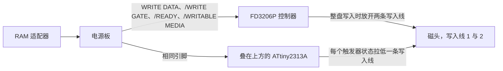

<div align="center">

<h1>fd3206-write-unlock</h1>

<strong>在 FD3206P 控制器上方焊一颗 ATtiny2313A，Famicom 磁碟机的驱动器就能重新写入整张磁盘。</strong>

[English](README.md) | [日本語](README.ja.md) | 简体中文 | [繁體中文](README.zh-HK.md)

[](https://github.com/gufranco/fd3206-write-unlock/actions/workflows/ci.yml)
[](https://github.com/gufranco/fd3206-write-unlock/releases/latest)
[](https://github.com/gufranco/fd3206-write-unlock/actions/workflows/ci.yml)
[](https://scorecard.dev/viewer/?uri=github.com/gufranco/fd3206-write-unlock)
[](LICENSE)

</div>

<p align="center">
  <a href="#安装">安装</a> |
  <a href="#工作原理">工作原理</a> |
  <a href="#两处锁定">电源板</a> |
  <a href="https://github.com/gufranco/fd3206-write-unlock/releases">发布版本</a> |
  <a href="#常见问题">常见问题</a>
</p>

<p align="center">
<b>8</b> 个焊点 · <b>0</b> 处切线 · <b>0</b> 个额外元件 · <b>230</b> 字节闪存 · <b>15</b> 条指令的边沿中断 · <b>0</b> 项 MISRA C:2012 问题 · <b>20</b> 个仿真场景
</p>

---

```text
ATtiny2313A, pin 1 over FD3206P pin 1
  solder  4 5 6 10 13 14 15 20
  clip    1 2 3 7 8 9 11 12 16 17 18 19
```

> [!IMPORTANT]
> 已在真实的 FD3206P 驱动器上分别测试 ATtiny2313A 和 ATtiny4313：整盘写入和游戏存档都能正确读回。写入任何磁盘之前请先备份。

<table>
<tr>
<td width="50%" valign="top">

**不切线，不加件**<br>
8 个引脚焊在下方的 FD3206P 上。不切断任何线路，不加导线、电阻或第二颗芯片。

</td>
<td width="50%" valign="top">

**只拉低，不驱动为高**<br>
每个写入线引脚要么输出 0，要么为输入，因此不会与共用该引脚的 FD3206P 对冲。

</td>
</tr>
<tr>
<td width="50%" valign="top">

**从边沿到磁头 10 个周期**<br>
汇编中断在 WRITE DATA 每个下降沿后 1.25 us 切换写入线；最近的两个边沿相隔 4.7 us。

</td>
<td width="50%" valign="top">

**MISRA C:2012 零问题**<br>
C17 代码在调试和正式两种配置下检查，所有寄存器访问都集中在一个汇编模块中。

</td>
</tr>
<tr>
<td width="50%" valign="top">

**每条指令都被执行**<br>
20 个 simavr 场景以三种时钟频率运行每种芯片的正式版映像，只要有一条指令从未执行就判为失败。

</td>
<td width="50%" valign="top">

**烧录的就是测试过的映像**<br>
每个发布版本都附有 CI 构建并仿真过的同一个 hex，以及它的 SHA-256 和签名的构建证明。

</td>
</tr>
</table>

## 问题

1988 年末以后生产的 Famicom 磁碟机驱动器用三美 FD3206P 控制器取代了 FD7201P。FD3206P 仍允许 RAM 适配器改写单个文件，但写入一旦覆盖整张磁盘，它就会放开磁头的两条写入线，RAM 适配器随即显示错误 26。这样的驱动器无法备份或恢复整张磁盘。

经典做法是切断两条铜箔，用 74LS76 触发器和 74LS45 驱动器重建驱动器的写入级。本固件就是同一个写入级，运行在叠焊于控制器之上的芯片里。

| | 本固件 | GAL16V8 改造芯片 | 经典接线改造 |
|:--|:--:|:--:|:--:|
| 新增元件 | 1 颗芯片 | 1 颗芯片 | 74LS76 与 74LS45 |
| 驱动器电路板切线 | 无 | 无 | 2 处 |
| 额外连线 | 无 | 1 根，1 脚到 19 脚 | 多根 |
| 写入线引脚 | 只拉低 | 双向驱动 | 集电极开路 |
| 单文件存档期间 | 不会与控制器短路 | 可能与控制器对冲 | 控制器已被断开 |
| 源代码与测试 | MIT，经过仿真，符合 MISRA | 开源版本提供 CUPL 源代码 | 原理图 |

## 工作原理



驱动器只有一个读写磁头，它的两条写入线位于 FD3206P 的 14 脚和 15 脚。拉低其中一条决定磁头电流的方向，每切换一次就写入一次磁通反转。

- **触发器。** WRITE DATA 接到 6 脚，即 ATtiny 的 INT0。每个下降沿，汇编处理程序先把下一条写入线状态写入端口，再交换两个为下一个边沿预先算好的值。它不改动标志位，也不触及 C 代码的状态。
- **门控。** 只有 /READY、/WRITABLE MEDIA 和 /WRITE GATE 全为低电平时，才会拉低一条写入线。主循环通过一次调用读取这三个条件并喂看门狗，条件变化时重新计算那两个值，关闭中断的时间最多 12 个周期。
- **开漏。** 被释放的写入线由驱动器自身的上拉电阻保持高电平，与原电路的集电极开路驱动器相同。FD3206P 与这两个引脚共用，而只会拉低的引脚不会与它短路。
- **输入上拉。** 四个输入保留 ATtiny 内部 20 至 50 kΩ 的上拉。ATtiny 需要 3.0 V 才能读为高电平，TTL 只需 2.0 V，上拉可以把偏弱的 TTL 高电平抬向 5 V。电源板本身已用 10 kΩ 上拉 /WRITE GATE。
- **看门狗。** 60 ms。复位后所有引脚都变为输入，两条写入线都被释放。

8 MHz 下的时序：

| 项目 | 数值 | 依据 |
|:--|:--|:--|
| 从响应中断到切换写入线 | 10 个周期，1.25 us | 指令计数 |
| 整个处理程序 | 约 30 个周期，3.75 us，低于 4.7 us 的边沿间隔 | 指令计数 |
| 各边沿之间的抖动 | 最多 3 个周期，375 ns | AVR 中断响应，主循环中最长的指令是 `ret` |
| 从门控变化到写入线释放或接通 | 最坏 7.4 us，7.2 MHz 时 8.2 us；上限 10 us | 在主循环的 64 个相位上仿真 |
| 同上，数据边沿以最快速率到达 | 最坏 19 us，7.2 MHz 时 23 us；上限 100 us | 仿真 |
| 条件变化时关闭中断的时间 | 12 个周期，1.5 us | 指令计数 |
| 内部振荡器容差 | 所有场景在 7.2、8.0 和 8.8 MHz 下均通过 | 以 ±10% 的频率仿真 |

驱动器以 96.4 kHz 写入，每位 10.4 us，因此 375 ns 的抖动是一位的 3.6%。门控变化发生在块与块之间至少 480 位的间隙内，几微秒的延迟只会让间隙略短或略长。

## 两处锁定

驱动器可能在两个地方阻止整盘写入，本芯片解除其中一处。

| 电路板 | 锁定 | 解除方式 |
|:--|:--|:--|
| 驱动机构，FD3206P 控制器 | 整盘写入时释放写入线 | 本芯片 |
| 驱动机构，FD7201P 控制器 | 无 | 无需处理 |
| 电源板 FMD-POWER-04、-05、部分 -02、Twin Famicom AN-500 | 在写入信号到达驱动器之前将其阻断的电路 | 安装第 2 步 |

配备 FMD-POWER-01 电源板的 FD3206P 驱动器只需要芯片。FD7201P 驱动器不需要芯片，但仍可能需要第 2 步。

## 安装

### 所需物品

| 物品 | 用途 |
|:--|:--|
| ATtiny2313A-PU 或 ATtiny4313-PU，DIP-20 封装 | 芯片本身；不带 A 的 ATtiny2313 和 AT90S2313 是不同的芯片，没有为它们构建映像 |
| USBasp，或运行 ArduinoISP 示例的 Arduino Uno 或 Nano | 烧录芯片 |
| `avrdude` | macOS 上 `brew install avrdude`，Debian 上 `apt install avrdude` |
| 万用表、1 kΩ 电阻、钩式探针 | 第 4 步的测量 |
| 细头电烙铁 | 第 2 步和第 5 步 |
| Docker 与 Python 3 | 仅在自行构建固件时需要 |

### 第 1 步：确认电源板版本

1. 拧下主机底部的 6 颗十字螺丝。
2. 将主机翻过来，取下上盖。
3. 拧下电池盒的 2 颗螺丝，把电池盒移到一旁。
4. 拧下电源板的螺丝，取出电源板。
5. 在元件面上，找到 `©198X Nintendo` 旁边的 `FMD-POWER-XX` 型号。

| 型号 | 锁定 | 操作 |
|:--|:--:|:--|
| FMD-POWER-01 | 无 | 无需操作 |
| FMD-POWER-02，无绿色子板 | 无 | 无需操作 |
| FMD-POWER-02，有绿色子板 | 有，在子板上 | 第 2a 步 |
| FMD-POWER-03 | 无资料，推测与 -02 相同 | 检查是否有子板；若没有子板，而装上芯片后整盘写入仍失败，则怀疑是这块电源板 |
| FMD-POWER-04 | 有 | 第 2b 步 |
| FMD-POWER-05 | 有 | 第 2c 步 |
| 夏普 Twin Famicom | 有，AN-505 可能没有 | 第 2d 步 |

### 第 2 步：解除电源板的写入锁定

Famicom World 的文章 [FDS Power Board Modifications](https://famicomworld.com/workshop/tech/fds-power-board-modifications/) 提供了每种电路板的照片，并标出了每个操作点。以下步骤说明每项改动的作用；具体位置请参照照片。

#### 2a. 带子板的 FMD-POWER-02

1. 拆焊并取下绿色子板。
2. 清除留下的孔中的焊锡。
3. 从子板上拆焊驱动器接插件。
4. 将该接插件装入电源板原有的孔位并焊好。

完成后，电路板与无锁定的 -02 相同。

#### 2b. FMD-POWER-04

1. 拆焊或剪掉标有 JP14 的元件。这会使锁定电路失效。
2. 用一段短导线连接文章中标为 A 和 B 的两点；两点相距很近时也可以用焊锡桥接。这样写入信号就能绕过该电路。

这块电路板无需切断铜箔。

#### 2c. FMD-POWER-05

1. 拆焊文章中标出的两根跳线。其中一根位于 RAM 适配器接口附近两个黑色方形元件的下方；把这两个元件向外轻轻扳开即可够到。
2. 切断文章中用红色标出的两条铜箔，并用万用表确认两处切口都已不导通。
3. 焊上文章中用蓝色标出的两条连线。它们把写入信号重新送回驱动机构。

#### 2d. 夏普 Twin Famicom

Twin Famicom 使用相同的三美驱动机构，搭载 FD7201P 或 FD3206P，前面接的是夏普自己的电源板。

1. 打开主机，找到驱动机构的线缆所经过的电源板。
2. 找到两根灰色导线：一根进入电源板，另一根从电源板引出。
3. 在电源板一端将两根线拔下或剪断。
4. 把两根灰色导线互相连接，焊牢后做好绝缘。这样写入信号会绕过锁定电路。

> [!WARNING]
> 不同机器的导线颜色可能不同。剪线之前，请先把两根线都追踪到电源板上确认。

nesdev 论坛上的报告 `(as of 2026-09)`：

| 机型 | 报告 |
|:--|:--|
| Twin Famicom，未注明机型 | Chris Covell 于 2014 年附照片报告，两根导线的改造有效 |
| AN-500B，FD7201P 驱动器 | 2014 年和 2018 年各有一位机主被告知只需两根导线的改造；两人都未发布结果 |
| 所有搭载 FD3206P 驱动器的 Twin Famicom | 两根导线改造后控制器的锁定仍在，因此还需要本芯片 |
| AN-505 | 2026-09-03 的一篇帖子转述了 Discord 上的讨论，称该机型没有锁定；没有照片或测试佐证 |

### 第 3 步：烧录芯片

每个[发布版本](https://github.com/gufranco/fd3206-write-unlock/releases)都为每种芯片附有一个映像，即 `fd3206-write-unlock-attiny2313a.hex` 和 `fd3206-write-unlock-attiny4313.hex`，各附一个 `.sha256` 文件。使用 USBasp 时：

```sh
sha256sum -c fd3206-write-unlock-attiny2313a.hex.sha256
make fuses PROGRAMMER=usbasp
avrdude -c usbasp -p t2313a -U flash:w:fd3206-write-unlock-attiny2313a.hex:i
```

| 情况 | 改动 |
|:--|:--|
| ATtiny4313 | `make fuses MCU=attiny4313`，然后用 `-p t4313` 和 ATtiny4313 的映像运行 avrdude |
| 用 Arduino 作编程器 | 在 `make fuses` 后加上 `PROGRAMMER=arduino_as_isp PORT=/dev/cu.usbmodemXXXX` |
| 自行构建映像 | `make` 在版本固定的 Docker 工具链中构建，`make flash PROGRAMMER=usbasp` 负责烧录 |

`make fuses` 写入低位 `0xE4`，即内部 8 MHz 振荡器、无时钟输出；高位 `0xD9`，即 4.3 V 掉电复位并保留串行编程；以及扩展位 `0xFF`。新芯片以 8 分频的 4 MHz 振荡器运行。固件在启动时把分频系数设为 1，因此未设置熔丝的芯片也能以 4 MHz 工作，但边沿抖动会加倍，且没有掉电复位。

### 第 4 步：测量驱动器

在未装芯片、未插入磁盘的状态下进行以下测量。

1. 通电：14 脚和 15 脚待机时不高于 5.5 V。应约为 5 V；更高会超出 ATtiny 引脚的额定值。
2. 通电：在 14 脚与 GND 之间接一个 1 kΩ 电阻，读取 14 脚的电压 V，再对 15 脚重复一次。以第 1 项测得的待机电压为 V0，源电阻为 1000 x (V0 - V) / V Ω。它必须不小于 250 Ω，这样 ATtiny 拉低的写入线电流不超过 20 mA。低于 250 Ω 时请勿安装。电阻只接几秒：它可能会让磁头通电，因此不得插入磁盘。
3. 如果要使用 FDSStick 或其他不经 RAM 适配器、直接连接驱动器的设备：在它读取一张坏了也无所谓的磁盘的整个过程中，4 脚 /WRITE GATE 必须始终不低于 3.0 V。只要驱动器已就绪、磁盘可写且 4 脚为低电平，本芯片就会写入。早期的一款商业改造芯片在 FDSStick 读取期间会抹掉磁盘，直到 FDSStick 软件 20160214 才解决。如果 4 脚低于 3.0 V，请不要在这台驱动器上用该设备读取磁盘。

### 第 5 步：安装芯片

| ATtiny 引脚 | FD3206P 信号 | 操作 |
|:--|:--|:--:|
| 4，PA1 | /WRITE GATE | 焊接 |
| 5，PA0 | /WRITABLE MEDIA，低电平表示可写 | 焊接 |
| 6，PD2 INT0 | WRITE DATA | 焊接 |
| 10 | GND | 焊接 |
| 13，PB1 | /READY | 焊接 |
| 14，PB2 | 写入线 2 | 焊接 |
| 15，PB3 | 写入线 1 | 焊接 |
| 20 | +5 V | 焊接 |
| 1、2、3、7、8、9、11、12、16、17、18、19 | 无资料 | 剪掉 |

Famicom World 的电路板照片把 5 脚标为 /WRITE PROTECT；电源板和 RAM 适配器把同一信号称为 /writable media。

1. 将标为"剪掉"的引脚弯开或剪掉，使其无法接触 FD3206P。固件用不到这些引脚，而 FD3206P 在下方对应引脚上的功能也无人记录过。
2. 取出驱动机构，拆下底板，露出控制器电路板。
3. 把 ATtiny 以 1 脚对 1 脚的方式放在 FD3206P 上，两颗芯片的缺口朝向一致。
4. 把标为"焊接"的 8 个引脚焊到正下方的 FD3206P 引脚上。
5. 在断电状态下，用万用表确认相邻引脚之间没有连通，且 20 脚与 10 脚之间没有短路。FD3206P 无法更换，其上的焊锡桥接是最可能损坏驱动器的原因。
6. 在芯片上方对应的位置贴上胶带，再装回底板。

### 第 6 步：测试

写入任何磁盘之前请先备份，并用一张坏了也无所谓的磁盘测试。

1. 保存一次游戏进度，然后读回存档。参见[单文件存档](#单文件存档)。
2. 用磁盘写入工具改写整张磁盘，然后反复读取几次。
3. 写入期间，被拉低的引脚不高于 0.8 V。
4. 用逻辑分析仪观察 6 脚与 14、15 脚，WRITE DATA 的每个下降沿都会使低电平从一条写入线移到另一条。

如果整盘写入仍然失败，请检查写入期间 WRITE DATA 和 /WRITE GATE 是否到达 FD3206P 的 6 脚和 4 脚。如果没有到达，说明电源板仍在阻断信号。

## 行为要求

每条要求都由一个仿真场景检查，该场景在 7.2、8.0 和 8.8 MHz 下运行每种芯片的正式版映像。门控与写入线选择还针对输入端口全部 65,536 种组合进行了检查。

| 要求 | 场景 |
|:--|:--|
| 除非 /READY、/WRITABLE MEDIA 和 /WRITE GATE 全为低电平，否则两条写入线引脚都必须为输入 | 一个条件为高，100 个下降沿：每个边沿后两条写入线均被释放 |
| 写入期间必须恰好有一条写入线引脚为低，且在 WRITE DATA 的每个下降沿都必须切换 | 间隔 4.7 us 的 1000 个边沿：每个边沿后只有一个为低，且每次换到另一个 |
| WRITE DATA 的上升沿不得改变写入线 | 1 us 的低电平脉冲：写入线只在下降沿变化一次 |
| 写入开始时使用的写入线必须与经典触发器一样，按下降沿的计数决定，即使在写入线释放期间也是如此 | 门控关闭时经过 100 或 101 个边沿，然后门控打开：偶数时为写入线 1，奇数时为写入线 2 |
| WRITE DATA 保持低电平时写入线不得再次改变 | 低电平 20 us：写入线只在下降沿变化一次 |
| 门控打开期间到达的边沿不得丢失 | 门控打开后在 96 个周期位置各施加一个边沿：之后的写入线始终与边沿计数一致 |
| 任一条件变高后 10 us 内必须释放写入线 | 依次测试每个条件，之后无边沿：10 us 内两个均被释放 |
| 所有条件变低后 10 us 内必须恰好驱动一条写入线 | 其他条件为低时 /WRITE GATE 下降：10 us 内一个为低 |
| 写入门控出现毛刺后，写入线必须最终处于释放状态 | 250 ns 的门控脉冲：之后两个均被释放 |
| 启动后不得有任何引脚为输出，每个输入都必须有上拉，写入线引脚不得有上拉 | 所有输入为高：方向寄存器全为零，四个输入有上拉，写入线没有 |
| 数据边沿以最快速率到达期间，/WRITE GATE 变高后 100 us 内必须释放写入线 | 最快数据中关闭门控：100 us 内释放，之后 100 个边沿保持释放 |
| 数据边沿以最快速率到达期间，/WRITE GATE 变低后 100 us 内必须恰好驱动一条写入线 | 最快数据中打开门控：100 us 内一个为低，之后每个边沿切换 |
| 固件必须以不分频的时钟运行，并保持看门狗启用 | 以 8 分频启动的芯片，启动后：分频系数 1，看门狗以 60 ms 超时启用 |
| 正常工作期间看门狗不得触发 | 600 ms 的边沿，相当于超时时间的 10 倍：无复位，每个边沿后只有一个为低 |
| 主循环卡死时必须由看门狗复位，并恢复写入 | 主循环停止 100 ms：看门狗复位一次，之后 100 个边沿中每次只有一条写入线为低并交替 |

## 单文件存档

保存单个文件时，FD3206P 仍会用自己的触发器在同样的两个引脚上写入，而 ATtiny 也用自己的触发器驱动这两个引脚。如果两者不一致，两条写入线会同时被拉低，磁头中没有净电流，这次存档就会写错。

两者保持同步。本固件与 GAL 改造芯片的相位完全一致：从 0 开始，先驱动写入线 1，并在每个下降沿切换。在装有任一芯片的真实 FD3206P 驱动器上，游戏存档都能正确读回。

## 数据

<!-- figures:begin -->
| 项目 | 数值 |
|---|---|
| 闪存占用 | ATtiny2313A 为 230 字节，ATtiny4313 为 234 字节 |
| 边沿中断处理程序 | 15 条指令 |
| 固件源代码 | 非空行 194 行 |
<!-- figures:end -->

数值取自正式版构建。ATtiny4313 的映像多 4 个字节，因为它的 RAM 更大，启动时需要设置栈指针的高字节，这也是每种芯片各有自己映像的原因。

## 常见问题

<details>
<summary><strong>我的驱动器需要它吗？</strong></summary>
<br>

只有控制器是 FD3206P 时才需要。打开驱动机构，查看控制器电路板上那颗大芯片的型号。FD7201P 没有控制器锁定，但其电源板仍可能需要第 2 步。

</details>

<details>
<summary><strong>为什么不用 ATtiny85 等 8 脚芯片？</strong></summary>
<br>

写入级需要 6 个 I/O：WRITE DATA、三个条件和两条写入线。8 脚的 ATtiny 在不放弃 RESET 的情况下只有 5 个，而放弃 RESET 就无法在线编程。此外只有 x313 的 GND、VCC 和 INT0 恰好位于 FD3206P 的 GND、+5 V 和 WRITE DATA 的位置，这正是能够叠焊安装的原因。

</details>

<details>
<summary><strong>"V4" 改造芯片上翘起的两个引脚是什么？</strong></summary>
<br>

是 1 脚和 19 脚，用一根导线相连。寄存器模式下的 GAL16V8 只能从 1 脚的上升沿获取触发器时钟，而驱动器在 WRITE DATA 的下降沿翻转，因此 GAL 把 WRITE DATA 反相后从输出脚 19 送出，再接回自己的时钟脚。两者都不是复位脚。市售的"FD3206 Add-On Chip V4"出售时磨掉了芯片标记，其安装照片显示了同样的跳线，因此很可能是同一种 GAL 设计；这是根据照片作出的推断。ATtiny 不需要这种回接，INT0 直接在下降沿触发。

</details>

<details>
<summary><strong>能用 Arduino IDE 构建吗？</strong></summary>
<br>

不能。Arduino IDE 只用于把 ArduinoISP 烧录到充当编程器的 Arduino 上。固件在版本固定的工具链中构建，确保每颗芯片烧录的都是通过了 MISRA 检查、测试和仿真的映像。

</details>

<details>
<summary><strong>能用于夏普 Twin Famicom 吗？</strong></summary>
<br>

驱动机构相同，因此搭载 FD3206P 的机器可以同样安装本芯片。它的电源板有自己的锁定，按第 2d 步连接两根灰色导线即可解除。

</details>

## 版本管理

发布版本遵循[语义化版本](https://semver.org/)，在 CI 通过后由 `main` 自动生成。每个[发布版本](https://github.com/gufranco/fd3206-write-unlock/releases)都附有发布说明、每种芯片的 hex 及其 SHA-256、签名构建来源的 Sigstore 证明包、与两个映像绑定证明的 SPDX 软件物料清单，以及 MIT 许可证全文。来源证明在 GitHub 托管的运行器上生成，满足 SLSA Build Level 2。下载后可用以下命令校验：

```sh
gh attestation verify fd3206-write-unlock-attiny2313a.hex --repo gufranco/fd3206-write-unlock
```

## 支持

| 需求 | 渠道 |
|:--|:--|
| 缺陷报告或实机结果 | [GitHub Issues](https://github.com/gufranco/fd3206-write-unlock/issues) |
| 安全问题报告 | [安全政策](SECURITY.md) |

## 来源

本项目依据公开资料独立编写。代码与本 README 仅参考以下资料：

| 资料 | 采用的事实 |
|:--|:--|
| Famicom World，"[Famicom Disk System FD3206 Write Mod](https://famicomworld.com/workshop/tech/famicom-disk-system-fd3206-write-mod/)" | 其带标注的电路板照片中 FD3206P 的 +5 V、GND、/READY、/WRITE GATE、/WRITABLE MEDIA、WRITE DATA 焊盘，照片中 5 脚标为 /WRITE PROTECT；14、15 脚的写入线走线；其 74LS76 与 74LS45 原理图中的写入线驱动行为 |
| Famicom World，"[FDS Power Board Modifications](https://famicomworld.com/workshop/tech/fds-power-board-modifications/)" | 哪些电源板版本带有写入锁定，以及各自的解除方法 |
| nesdev 论坛帖子 [11342](https://forums.nesdev.org/viewtopic.php?t=11342)、[17037](https://forums.nesdev.org/viewtopic.php?t=17037)、[19856](https://forums.nesdev.org/viewtopic.php?t=19856) 及 "[Disable copy protection on the Twin Famicom AN-505BK](https://forums.nesdev.org/viewtopic.php?p=310336)" | Twin Famicom 电源板的改造方法与各机型的报告 |
| Brad Taylor，"[Famicom Disk System technical reference](https://www.nesdev.org/FDS%20technical%20reference.txt)"，nesdev.org | 96.4 kHz 位速率、10% 容差、1 us 脉冲、信号名称 |
| nesdev wiki，"[FDS RAM adaptor cable pinout](https://www.nesdev.org/wiki/FDS_RAM_adaptor_cable_pinout)" 与 "[FDS disk format](https://www.nesdev.org/wiki/FDS_disk_format)" | 信号名称与极性、间隙长度 |
| Microchip 文档 8246，[ATtiny2313A/4313](https://ww1.microchip.com/downloads/en/DeviceDoc/doc8246.pdf) | 引脚排列、输入输出电平、中断、看门狗与分频器的定时写入顺序、振荡器精度、电源电压范围、引脚电流 |
| nesdev 论坛，[FMD-POWER-05](https://forums.nesdev.org/viewtopic.php?t=17881) 逆向原理图 | 送到驱动板的电源只有 +5 V 和电机用 +5 V；/write 上的 10 kΩ 上拉；信号名 /writable media |
| [avrdude 8](https://github.com/avrdudes/avrdude/blob/main/src/avrdude.conf.in) 器件数据库 | 熔丝位的含义与出厂值 |
| [FDSStick](https://www.fdsstick.com/the-latest-fd3206-modchip-v4-no-need-any-wires/) 与 [ToToTEK](https://www.tototek.com/store/index.php?main_page=product_info&products_id=228) 的 FD3206 V4 附加芯片产品页面 | 显示 8 个焊点和 1 脚到 19 脚跳线的安装照片，仅用于比较 |

[Stephen-Arsenault/FDS-FD3206-Modchip](https://github.com/Stephen-Arsenault/FDS-FD3206-Modchip)，CC BY-SA 4.0，在同一控制器上叠放可编程逻辑器件。本项目不含该项目的任何文件、源代码、照片、文档文字或名称；控制器的引脚编号是对照 Famicom World 的电路板照片确认的，而非取自该项目。两者功能相同，因为那是驱动器本身的功能；实现方式不同：GAL 是组合逻辑加一个通过导线回接获得时钟的寄存器，本项目则是 C 语言主循环加一段汇编中断处理程序，交换两个预先算好的端口值，并以开漏方式驱动引脚。没有任何连续 4 行以上的内容相同，固件中也不含第三方代码。

## 许可证

[MIT](LICENSE)
