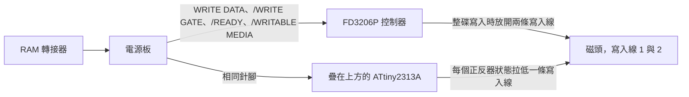

<div align="center">

<h1>fd3206-write-unlock</h1>

<strong>在 FD3206P 控制器上方焊一粒 ATtiny2313A，Famicom 磁碟機的驅動器便可以再次寫入整張磁碟。</strong>

[English](README.md) | [日本語](README.ja.md) | [简体中文](README.zh-CN.md) | 繁體中文

[](https://github.com/gufranco/fd3206-write-unlock/actions/workflows/ci.yml)
[](https://github.com/gufranco/fd3206-write-unlock/releases/latest)
[](https://scorecard.dev/viewer/?uri=github.com/gufranco/fd3206-write-unlock)
[](https://github.com/gufranco/fd3206-write-unlock/actions/workflows/ci.yml)
[](LICENSE)

</div>

<p align="center">
  <a href="#安裝">安裝</a> |
  <a href="#運作原理">運作原理</a> |
  <a href="#兩處鎖定">電源板</a> |
  <a href="https://github.com/gufranco/fd3206-write-unlock/releases">發佈版本</a> |
  <a href="#常見問題">常見問題</a>
</p>

<p align="center">
<b>8</b> 個焊點 · <b>0</b> 處切線 · <b>0</b> 件額外元件 · <b>230</b> 位元組快閃記憶體 · <b>15</b> 條指令的邊緣中斷 · <b>0</b> 項 MISRA C:2012 問題 · <b>20</b> 個模擬場景
</p>

---

```text
ATtiny2313A, pin 1 over FD3206P pin 1
  solder  4 5 6 10 13 14 15 20
  clip    1 2 3 7 8 9 11 12 16 17 18 19
```

> [!IMPORTANT]
> 已在真實的 FD3206P 驅動器上分別測試 ATtiny2313A 和 ATtiny4313：整碟寫入和遊戲存檔都能正確讀回。寫入任何磁碟之前請先備份。

<table>
<tr>
<td width="50%" valign="top">

**不切線，不加料**<br>
8 支針腳焊在下方的 FD3206P 上。不切斷銅箔，不加電線、電阻或第二粒晶片。

</td>
<td width="50%" valign="top">

**只拉低，從不驅動為高**<br>
每支寫入線針腳要麼輸出 0，要麼是輸入，因此不會與共用該針腳的 FD3206P 互相對衝。

</td>
</tr>
<tr>
<td width="50%" valign="top">

**由邊緣到磁頭 10 個週期**<br>
組合語言中斷在 WRITE DATA 每個下降緣後 1.25 us 切換寫入線；最接近的兩個邊緣相隔 4.7 us。

</td>
<td width="50%" valign="top">

**MISRA C:2012，零問題**<br>
C17 程式碼在除錯及正式兩種配置下都經過檢查，所有暫存器存取都集中在一個組合語言模組中。

</td>
</tr>
<tr>
<td width="50%" valign="top">

**每條指令都被執行**<br>
20 個 simavr 場景以三種時鐘速度運行每款晶片的正式版映像，只要有一條指令從未執行便判為失敗。

</td>
<td width="50%" valign="top">

**燒錄的就是測試過的映像**<br>
每個發佈版本都附有 CI 建置並模擬過的同一個 hex，連同其 SHA-256 及已簽署的建置證明。

</td>
</tr>
</table>

## 問題

1988 年底起生產的 Famicom 磁碟機驅動器以三美 FD3206P 控制器取代 FD7201P。FD3206P 仍容許 RAM 轉接器改寫單一檔案，但寫入一旦覆蓋整張磁碟，便會放開磁頭的兩條寫入線，RAM 轉接器隨即顯示錯誤 26。這類驅動器無法備份或還原整張磁碟。

經典做法是切斷兩條銅箔，再用一粒 74LS76 正反器和一粒 74LS45 驅動器重建驅動器的寫入級。本韌體就是同一個寫入級，在疊焊於控制器上的晶片裏運行。

| | 本韌體 | GAL16V8 改裝晶片 | 經典接線改裝 |
|:--|:--:|:--:|:--:|
| 新增元件 | 1 粒晶片 | 1 粒晶片 | 74LS76 與 74LS45 |
| 驅動器電路板切線 | 沒有 | 沒有 | 2 處 |
| 額外連線 | 沒有 | 1 條，1 腳至 19 腳 | 多條 |
| 寫入線針腳 | 只拉低 | 雙向驅動 | 開集極 |
| 單一檔案存檔期間 | 不會與控制器短路 | 可能與控制器對衝 | 控制器已被斷開 |
| 原始碼與測試 | MIT，經過模擬，符合 MISRA | 開源版本提供 CUPL 原始碼 | 電路圖 |

## 運作原理



驅動器只有一個讀寫磁頭，兩條寫入線位於 FD3206P 的 14 腳和 15 腳。拉低其中一條決定磁頭電流的方向，每切換一次便寫入一次磁通反轉。

- **正反器。** WRITE DATA 接到 6 腳，即 ATtiny 的 INT0。每個下降緣，組合語言處理程式先把下一個寫入線狀態寫入連接埠，再交換兩個為下一個邊緣預先計算好的數值。它不改動旗標，亦不觸及 C 程式碼的狀態。
- **閘控。** 只有在 /READY、/WRITABLE MEDIA 和 /WRITE GATE 全為低電平時才會拉低一條寫入線。主迴圈以一次呼叫讀取這三個條件並重設看門狗，條件改變時重新計算兩個數值，期間停用中斷最多 12 個週期。
- **開汲極。** 被釋放的寫入線由驅動器本身的上拉電阻保持高電平，與原本的開集極驅動器一樣。FD3206P 共用這兩支針腳，而只會拉低的針腳不會與它短路。
- **輸入上拉。** 四個輸入都保留 ATtiny 內置 20 至 50 kΩ 的上拉。ATtiny 需要 3.0 V 才會讀為高電平，而 TTL 只需 2.0 V，上拉可把偏弱的 TTL 高電平抬向 5 V。電源板本身已用 10 kΩ 上拉 /WRITE GATE。
- **看門狗。** 60 ms。重設後所有針腳都變成輸入，兩條寫入線都會被釋放。

8 MHz 下的時序：

| 項目 | 數值 | 依據 |
|:--|:--|:--|
| 由回應中斷至寫入線切換 | 10 個週期，1.25 us | 指令數 |
| 整個處理程式 | 約 30 個週期，3.75 us，低於 4.7 us 的邊緣間隔 | 指令數 |
| 各邊緣之間的差異 | 最多 3 個週期，375 ns | AVR 中斷回應，主迴圈中最長的指令是 `ret` |
| 由閘控改變至寫入線釋放或接通 | 最差 7.4 us，7.2 MHz 時 8.2 us；上限 10 us | 在主迴圈 64 個相位上模擬 |
| 同上，期間資料邊緣以最快速率到達 | 最差 19 us，7.2 MHz 時 23 us；上限 100 us | 模擬 |
| 條件改變時停用中斷的時間 | 12 個週期，1.5 us | 指令數 |
| 內部振盪器容差 | 所有場景在 7.2、8.0 及 8.8 MHz 下均通過 | 以 +/-10% 模擬 |

驅動器以 96.4 kHz 寫入，每個位元 10.4 us，因此 375 ns 的差異只是一個位元的 3.6%。閘控改變發生在區塊之間至少 480 位元的間隙內，數微秒的延遲只會令間隙稍短或稍長。

## 兩處鎖定

驅動器可以在兩個地方阻止整碟寫入，本晶片解除其中一處。

| 電路板 | 鎖定 | 解除方法 |
|:--|:--|:--|
| 驅動機構，FD3206P 控制器 | 整碟寫入時釋放寫入線 | 本晶片 |
| 驅動機構，FD7201P 控制器 | 沒有 | 毋須處理 |
| 電源板 FMD-POWER-04、-05、部分 -02、Twin Famicom AN-500 | 在寫入訊號到達驅動器之前將其截斷的電路 | 安裝第 2 步 |

配備 FMD-POWER-01 電源板的 FD3206P 驅動器只需要晶片。FD7201P 驅動器不需要晶片，但仍可能需要第 2 步。

## 安裝

### 所需物品

| 物品 | 用途 |
|:--|:--|
| ATtiny2313A-PU 或 ATtiny4313-PU，DIP-20 | 晶片本身；不帶 A 的 ATtiny2313 及 AT90S2313 是不同的晶片，並無為它們建置映像 |
| USBasp，或運行 ArduinoISP 範例的 Arduino Uno 或 Nano | 燒錄晶片 |
| `avrdude` | macOS 上 `brew install avrdude`，Debian 上 `apt install avrdude` |
| 萬用錶、1 kΩ 電阻、鈎式探針 | 第 4 步的量度 |
| 幼頭焊鐵 | 第 2 步及第 5 步 |
| Docker 與 Python 3 | 只在自行建置韌體時需要 |

### 第 1 步：確認電源板版本

1. 拆下機身底部的 6 粒十字螺絲。
2. 將機身反轉，取下上蓋。
3. 拆下電池盒的 2 粒螺絲，把電池盒移到一旁。
4. 拆下電源板的螺絲，取出電源板。
5. 在元件面上，讀出 `©198X Nintendo` 旁邊的 `FMD-POWER-XX` 型號。

| 型號 | 鎖定 | 操作 |
|:--|:--:|:--|
| FMD-POWER-01 | 沒有 | 毋須操作 |
| FMD-POWER-02，沒有綠色子板 | 沒有 | 毋須操作 |
| FMD-POWER-02，有綠色子板 | 有，在子板上 | 第 2a 步 |
| FMD-POWER-03 | 沒有資料，推斷與 -02 相同 | 檢查有沒有子板；若沒有子板，而裝上晶片後整碟寫入仍然失敗，便懷疑是這塊電源板 |
| FMD-POWER-04 | 有 | 第 2b 步 |
| FMD-POWER-05 | 有 | 第 2c 步 |
| 聲寶 Twin Famicom | 有，AN-505 可能沒有 | 第 2d 步 |

### 第 2 步：解除電源板的寫入鎖定

Famicom World 的文章 [FDS Power Board Modifications](https://famicomworld.com/workshop/tech/fds-power-board-modifications/) 附有每款電路板的相片，並標示了每個操作位置。以下步驟說明每項改動的作用；位置請參照相片。

#### 2a. 附子板的 FMD-POWER-02

1. 拆焊並取下綠色子板。
2. 清除留下的孔中的焊錫。
3. 從子板上拆焊驅動器插座。
4. 將該插座裝入電源板原有的孔位並焊好。

完成後，電路板便與沒有鎖定的 -02 相同。

#### 2b. FMD-POWER-04

1. 拆焊或剪走標有 JP14 的元件。這樣會令鎖定電路失效。
2. 用一段短電線連接文章中標為 A 和 B 的兩點；兩點相近時亦可以用焊錫橋接。寫入訊號便會繞過該電路。

這塊電路板毋須切斷銅箔。

#### 2c. FMD-POWER-05

1. 拆焊文章中標示的兩條跳線。其中一條位於 RAM 轉接器接口附近兩粒黑色方形元件的下方；把這兩粒元件稍為向外扳開便可觸及。
2. 切斷文章中以紅色標示的兩條銅箔，並用萬用錶確認兩個切口都已不導通。
3. 焊上文章中以藍色標示的兩條連線。它們會把寫入訊號重新送回驅動機構。

#### 2d. 聲寶 Twin Famicom

Twin Famicom 使用相同的三美驅動機構，配備 FD7201P 或 FD3206P，但前面是聲寶自家的電源板。

1. 打開機身，找出驅動機構排線所經過的電源板。
2. 找出兩條灰色電線：一條進入電源板，另一條從電源板引出。
3. 在電源板一端拔出或剪斷這兩條電線。
4. 把兩條灰色電線互相接駁，焊牢並做好絕緣。寫入訊號便會繞過鎖定電路。

> [!WARNING]
> 不同機身的電線顏色可能不同。剪線之前，請先把兩條電線都追蹤到電源板上確認。

nesdev 論壇上的報告 `(as of 2026-09)`：

| 型號 | 報告 |
|:--|:--|
| Twin Famicom，未註明型號 | Chris Covell 於 2014 年附相片報告，兩條電線的改裝有效 |
| AN-500B，FD7201P 驅動器 | 2014 年及 2018 年各有一位機主獲告知只需兩條電線的改裝；兩人都沒有公布結果 |
| 所有配備 FD3206P 驅動器的 Twin Famicom | 兩條電線改裝後控制器的鎖定仍然存在，因此亦需要本晶片 |
| AN-505 | 2026-09-03 的一篇帖子轉述了 Discord 上的討論，指該型號沒有鎖定；沒有相片或測試佐證 |

### 第 3 步：燒錄晶片

每個[發佈版本](https://github.com/gufranco/fd3206-write-unlock/releases)都為每款晶片附有一個映像，即 `fd3206-write-unlock-attiny2313a.hex` 及 `fd3206-write-unlock-attiny4313.hex`，各附一個 `.sha256` 檔案。使用 USBasp 時：

```sh
sha256sum -c fd3206-write-unlock-attiny2313a.hex.sha256
make fuses PROGRAMMER=usbasp
avrdude -c usbasp -p t2313a -U flash:w:fd3206-write-unlock-attiny2313a.hex:i
```

| 情況 | 改動 |
|:--|:--|
| ATtiny4313 | `make fuses MCU=attiny4313`，然後以 `-p t4313` 及 ATtiny4313 的映像執行 avrdude |
| 以 Arduino 作燒錄器 | 在 `make fuses` 加上 `PROGRAMMER=arduino_as_isp PORT=/dev/cu.usbmodemXXXX` |
| 自行建置映像 | `make` 在版本固定的 Docker 工具鏈中建置，`make flash PROGRAMMER=usbasp` 負責燒錄 |

`make fuses` 寫入低位 `0xE4`，即內部 8 MHz 振盪器、沒有時鐘輸出；高位 `0xD9`，即 4.3 V 欠壓重設並保留串列燒錄；以及擴展位 `0xFF`。新晶片以 8 分頻的 4 MHz 振盪器運行。韌體在啟動時把分頻系數設為 1，因此未設定熔絲的晶片亦可以 4 MHz 運作，但邊緣差異會加倍，而且沒有欠壓重設。

### 第 4 步：量度驅動器

以下量度在未裝晶片、沒有放入磁碟的情況下進行。

1. 通電：14 腳和 15 腳待機時不高於 5.5 V。應約為 5 V；更高會超出 ATtiny 針腳的額定值。
2. 通電：在 14 腳與 GND 之間夾上一個 1 kΩ 電阻，讀取 14 腳電壓 V，然後在 15 腳重複一次。以第 1 項的待機電壓為 V0，源電阻為 1000 x (V0 - V) / V Ω。它必須不少於 250 Ω，這樣 ATtiny 拉低的寫入線電流最多 20 mA。低於 250 Ω 時請勿安裝。電阻只接幾秒：它可能會令磁頭通電，因此不可放入磁碟。
3. 如果會使用 FDSStick 或其他不經 RAM 轉接器、直接連接驅動器的裝置：在它讀取一張壞了也不要緊的磁碟的整個過程中，4 腳的 /WRITE GATE 必須一直不低於 3.0 V。只要驅動器已就緒、磁碟可寫而 4 腳為低電平，本晶片便會寫入。早期一款商業改裝晶片在 FDSStick 讀取期間會抹走磁碟，直到 FDSStick 軟件 20160214 才解決。如果 4 腳低於 3.0 V，請不要在這部驅動器上用該裝置讀取磁碟。

### 第 5 步：安裝晶片

| ATtiny 針腳 | FD3206P 訊號 | 操作 |
|:--|:--|:--:|
| 4，PA1 | /WRITE GATE | 焊接 |
| 5，PA0 | /WRITABLE MEDIA，低電平表示可寫 | 焊接 |
| 6，PD2 INT0 | WRITE DATA | 焊接 |
| 10 | GND | 焊接 |
| 13，PB1 | /READY | 焊接 |
| 14，PB2 | 寫入線 2 | 焊接 |
| 15，PB3 | 寫入線 1 | 焊接 |
| 20 | +5 V | 焊接 |
| 1、2、3、7、8、9、11、12、16、17、18、19 | 沒有資料 | 剪走 |

Famicom World 的電路板相片把 5 腳標為 /WRITE PROTECT；電源板及 RAM 轉接器把同一訊號稱為 /writable media。

1. 將標為「剪走」的針腳屈開或剪走，令它們無法接觸 FD3206P。韌體用不上這些針腳，亦從未有人記錄 FD3206P 下方對應針腳的作用。
2. 取出驅動機構，拆下底板，露出控制器電路板。
3. 把 ATtiny 以 1 腳對 1 腳的方式放在 FD3206P 上，兩粒晶片的缺口方向一致。
4. 把標為「焊接」的 8 支針腳焊到正下方的 FD3206P 針腳上。
5. 在斷電狀態下，用萬用錶確認相鄰針腳之間沒有接通，而且 20 腳與 10 腳之間沒有短路。FD3206P 無法更換，其上的焊錫橋接是最有可能損壞驅動器的原因。
6. 在晶片上方對應的位置貼上膠紙，再裝回底板。

### 第 6 步：測試

寫入任何磁碟之前先作備份，並以一張壞了也不要緊的磁碟測試。

1. 儲存一次遊戲進度，然後讀回存檔。請參閱[單一檔案存檔](#單一檔案存檔)。
2. 用磁碟寫入工具改寫整張磁碟，然後重複讀取數次。
3. 寫入期間，被拉低的針腳不高於 0.8 V。
4. 用邏輯分析儀接上 6 腳及 14、15 腳，WRITE DATA 每個下降緣都會令低電平由一條寫入線移到另一條。

如果整碟寫入仍然失敗，請檢查寫入期間 WRITE DATA 和 /WRITE GATE 有沒有到達 FD3206P 的 6 腳和 4 腳。如果沒有到達，代表電源板仍在截斷訊號。

## 行為要求

每項要求都由一個模擬場景驗證，該場景在 7.2、8.0 及 8.8 MHz 下運行每款晶片的正式版映像。閘控與寫入線選擇亦針對輸入連接埠全部 65,536 種組合作出檢查。

| 要求 | 場景 |
|:--|:--|
| 除非 /READY、/WRITABLE MEDIA 和 /WRITE GATE 全為低電平，否則兩支寫入線針腳都必須為輸入 | 一個條件為高，100 個下降緣：每個邊緣後兩條寫入線均被釋放 |
| 寫入期間必須剛好有一支寫入線針腳為低，而且在 WRITE DATA 的每個下降緣都必須切換 | 間隔 4.7 us 的 1000 個邊緣：每個邊緣後只有一支為低，並每次換到另一支 |
| WRITE DATA 的上升緣不得改變寫入線 | 1 us 的低電平脈衝：寫入線只在下降緣改變一次 |
| 寫入開始時使用的寫入線必須與經典正反器一樣，按下降緣的計數決定，即使在寫入線釋放期間亦然 | 閘控關閉時經過 100 或 101 個邊緣，然後閘控打開：雙數時為寫入線 1，單數時為寫入線 2 |
| WRITE DATA 保持低電平時寫入線不得再次改變 | 低電平 20 us：寫入線只在下降緣改變一次 |
| 閘控打開期間到達的邊緣不得遺失 | 閘控打開後在 96 個週期位置各施加一個邊緣：之後的寫入線始終與邊緣計數一致 |
| 任何一個條件變高後 10 us 內必須釋放寫入線 | 逐一測試每個條件，之後沒有邊緣：10 us 內兩個均被釋放 |
| 所有條件變低後 10 us 內必須剛好驅動一條寫入線 | 其他條件為低時 /WRITE GATE 下降：10 us 內一支為低 |
| 寫入閘控出現突波後，寫入線最終必須處於釋放狀態 | 250 ns 的閘控脈衝：之後兩個均被釋放 |
| 啟動後不得有任何針腳為輸出，每個輸入都必須有上拉，寫入線針腳不得有上拉 | 所有輸入為高：方向暫存器全為零，四個輸入有上拉，寫入線沒有 |
| 資料邊緣以最快速率到達期間，/WRITE GATE 變高後 100 us 內必須釋放寫入線 | 最快資料中關閉閘控：100 us 內釋放，之後 100 個邊緣保持釋放 |
| 資料邊緣以最快速率到達期間，/WRITE GATE 變低後 100 us 內必須剛好驅動一條寫入線 | 最快資料中打開閘控：100 us 內一支為低，之後每個邊緣切換 |
| 韌體必須以不分頻的時鐘運行，並保持看門狗啟用 | 以 8 分頻啟動的晶片，啟動後：分頻系數 1，看門狗以 60 ms 逾時啟用 |
| 正常運作期間看門狗不得觸發 | 600 ms 的邊緣，相當於逾時時間的 10 倍：沒有重設，每個邊緣後只有一支為低 |
| 主迴圈停頓時必須由看門狗重設，並恢復寫入 | 主迴圈停止 100 ms：看門狗重設一次，之後 100 個邊緣中每次只有一支寫入線為低並交替 |

## 單一檔案存檔

儲存單一檔案時，FD3206P 仍會以自己的正反器在同樣的兩支針腳上寫入，而 ATtiny 亦以自己的正反器驅動這兩支針腳。如果兩者不一致，兩條寫入線會同時被拉低，磁頭中沒有淨電流，這次存檔便會寫錯。

兩者保持同步。本韌體與 GAL 改裝晶片的相位完全一致：由 0 開始，先驅動寫入線 1，並在每個下降緣切換。在裝有任一晶片的真實 FD3206P 驅動器上，遊戲存檔都能正確讀回。

## 數據

<!-- figures:begin -->
| 項目 | 數值 |
|---|---|
| 快閃記憶體用量 | ATtiny2313A 為 230 位元組，ATtiny4313 為 234 位元組 |
| 邊緣中斷處理程式 | 15 條指令 |
| 韌體原始碼 | 非空行 194 行 |
<!-- figures:end -->

數值取自正式版建置。ATtiny4313 的映像大 4 位元組，因為其 RAM 較大，啟動時須設定堆疊指標的高位元組，這亦是每款晶片各有映像的原因。

## 常見問題

<details>
<summary><strong>我的驅動器需要它嗎？</strong></summary>
<br>

只有控制器是 FD3206P 時才需要。打開驅動機構，查看控制器電路板上那粒大晶片的型號。FD7201P 沒有控制器鎖定，但其電源板仍可能需要第 2 步。

</details>

<details>
<summary><strong>為甚麼不用 ATtiny85 等 8 腳晶片？</strong></summary>
<br>

寫入級需要 6 個 I/O：WRITE DATA、三個條件和兩條寫入線。8 腳的 ATtiny 在不放棄 RESET 的情況下只有 5 個，而放棄 RESET 便無法在線燒錄。此外只有 x313 的 GND、VCC 和 INT0 恰好位於 FD3206P 的 GND、+5 V 和 WRITE DATA 的位置，這正是可以疊焊安裝的原因。

</details>

<details>
<summary><strong>「V4」改裝晶片上翹起的兩支針腳是甚麼？</strong></summary>
<br>

是 1 腳和 19 腳，以一條電線相連。暫存器模式下的 GAL16V8 只能從 1 腳的上升緣取得正反器時鐘，而驅動器在 WRITE DATA 的下降緣翻轉，因此 GAL 把 WRITE DATA 反相後從輸出腳 19 送出，再接回自己的時鐘腳。兩者都不是重設腳。市面出售的「FD3206 Add-On Chip V4」已磨走晶片標記，但其安裝相片顯示了同樣的跳線，因此很可能是同一種 GAL 設計；這是根據相片作出的推斷。ATtiny 不需要這種回接，INT0 直接在下降緣觸發。

</details>

<details>
<summary><strong>可以用 Arduino IDE 建置嗎？</strong></summary>
<br>

不可以。Arduino IDE 只用來把 ArduinoISP 燒進充當燒錄器的 Arduino。韌體在版本固定的工具鏈中建置，確保每粒晶片燒錄的都是通過了 MISRA 檢查、測試及模擬的映像。

</details>

<details>
<summary><strong>可以用於聲寶 Twin Famicom 嗎？</strong></summary>
<br>

驅動機構相同，因此配備 FD3206P 的機器可以同樣安裝本晶片。它的電源板有自己的鎖定，在第 2d 步透過接駁兩條灰色電線解除。

</details>

## 版本管理

發佈版本遵循[語義化版本](https://semver.org/)，在 CI 通過後由 `main` 自動產生。每個[發佈版本](https://github.com/gufranco/fd3206-write-unlock/releases)都附有發佈說明、每款晶片的 hex 及其 SHA-256、已簽署建置來源的 Sigstore 證明包、與兩個映像綁定證明的 SPDX 軟件物料清單，以及 MIT 授權條款全文。來源證明在 GitHub 託管的執行器上產生，符合 SLSA Build Level 2。下載後可用以下指令核對：

```sh
gh attestation verify fd3206-write-unlock-attiny2313a.hex --repo gufranco/fd3206-write-unlock
```

## 支援

| 需要 | 渠道 |
|:--|:--|
| 錯誤報告或真實驅動器的結果 | [GitHub Issues](https://github.com/gufranco/fd3206-write-unlock/issues) |
| 保安問題報告 | [保安政策](SECURITY.md) |

## 來源

本項目根據公開資料獨立編寫。程式碼及本 README 只參考以下資料：

| 資料 | 採用的事實 |
|:--|:--|
| Famicom World，「[Famicom Disk System FD3206 Write Mod](https://famicomworld.com/workshop/tech/famicom-disk-system-fd3206-write-mod/)」 | 其附標註的電路板相片中 FD3206P 的 +5 V、GND、/READY、/WRITE GATE、/WRITABLE MEDIA、WRITE DATA 焊盤，其中 5 腳標為 /WRITE PROTECT；14、15 腳的寫入線走線；其 74LS76 與 74LS45 電路圖中的寫入線驅動行為 |
| Famicom World，「[FDS Power Board Modifications](https://famicomworld.com/workshop/tech/fds-power-board-modifications/)」 | 哪些電源板版本設有寫入鎖定，以及各自的解除方法 |
| nesdev 論壇帖子 [11342](https://forums.nesdev.org/viewtopic.php?t=11342)、[17037](https://forums.nesdev.org/viewtopic.php?t=17037)、[19856](https://forums.nesdev.org/viewtopic.php?t=19856) 及「[Disable copy protection on the Twin Famicom AN-505BK](https://forums.nesdev.org/viewtopic.php?p=310336)」 | Twin Famicom 電源板的改裝方法與各型號的報告 |
| Brad Taylor，「[Famicom Disk System technical reference](https://www.nesdev.org/FDS%20technical%20reference.txt)」，nesdev.org | 96.4 kHz 位元速率、10% 容差、1 us 脈衝、訊號名稱 |
| nesdev wiki，「[FDS RAM adaptor cable pinout](https://www.nesdev.org/wiki/FDS_RAM_adaptor_cable_pinout)」與「[FDS disk format](https://www.nesdev.org/wiki/FDS_disk_format)」 | 訊號名稱與極性、間隙長度 |
| Microchip 文件 8246，[ATtiny2313A/4313](https://ww1.microchip.com/downloads/en/DeviceDoc/doc8246.pdf) | 針腳排列、輸入輸出電平、中斷、看門狗及分頻器的定時寫入次序、振盪器精度、電源電壓範圍、針腳電流 |
| nesdev 論壇，[FMD-POWER-05](https://forums.nesdev.org/viewtopic.php?t=17881) 逆向電路圖 | 送到驅動板的電源只有 +5 V 和摩打用 +5 V；/write 上的 10 kΩ 上拉；訊號名 /writable media |
| [avrdude 8](https://github.com/avrdudes/avrdude/blob/main/src/avrdude.conf.in) 裝置資料庫 | 熔絲位元的意義與出廠值 |
| [FDSStick](https://www.fdsstick.com/the-latest-fd3206-modchip-v4-no-need-any-wires/) 與 [ToToTEK](https://www.tototek.com/store/index.php?main_page=product_info&products_id=228) 的 FD3206 V4 附加晶片產品頁面 | 顯示 8 個焊點和 1 腳至 19 腳跳線的安裝相片，只用於比較 |

[Stephen-Arsenault/FDS-FD3206-Modchip](https://github.com/Stephen-Arsenault/FDS-FD3206-Modchip)，CC BY-SA 4.0，在同一控制器上疊放可程式邏輯元件。本項目不含該項目的任何檔案、原始碼、相片、文件文字或名稱；控制器的針腳編號是對照 Famicom World 的電路板相片確認，而非取自該項目。兩者功能相同，因為那是驅動器本身的功能；實作方式則不同：GAL 是組合邏輯加上一個經電線回接取得時鐘的暫存器，本項目則是 C 語言主迴圈加上一段組合語言中斷處理程式，交換兩個預先計算好的連接埠數值，並以開汲極方式驅動針腳。沒有任何連續 4 行或以上的程式碼相同，韌體中亦不含第三方程式碼。

## 授權

[MIT](LICENSE)
